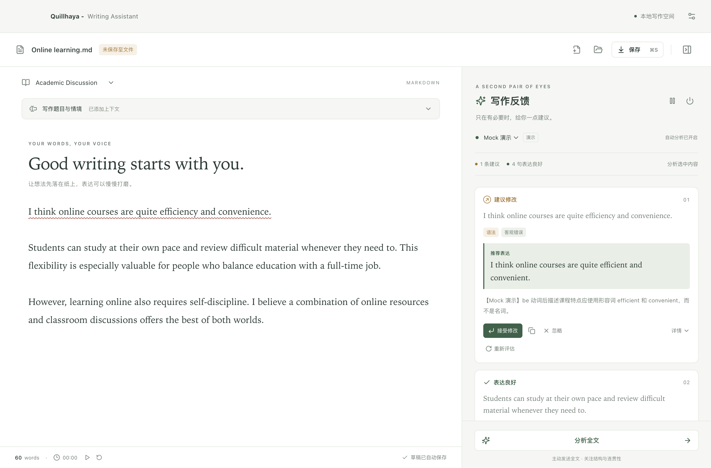

# Quillhaya - Writing Assistant

一个以写作为中心的 macOS Electron 桌面应用：左侧是 CodeMirror 6 Markdown 编辑器，右侧提供不打断输入的中文反馈。建议只在点击“接受修改”后应用，可通过 ⌘Z 撤销。



## 从源码启动

先安装 **Node.js ≥ 22.12**（含 npm），推荐使用 Apple Silicon 原生 arm64 版本。源码开发还需要 macOS 的 Xcode Command Line Tools，以生成应用图标；已安装完整 Xcode 时可直接使用。在项目目录执行：

```bash
npm ci
npm run dev
```

也可运行 `bash run.sh`，脚本会检查 Node.js 版本、按需安装依赖并启动应用。首次安装需要联网下载 Electron 运行时。

只编译源码、然后运行本地构建：

```bash
npm run build
npm start
```

## 先试一下

默认启用 **Mock 演示**，不需要密钥，不发送网络请求。点击“体验示例反馈”，或输入：

```text
I think online courses are quite efficiency and convenience.
Learning takes practice.
```

第一句出现中文语法解释和英文建议，第二句显示“表达良好”。Mock 只识别三个固定示例（`efficiency and convenience`、`I am agree`、`He go`）；其他完整句子按良好表达展示，**不是实际语言质量判断**。设置中可以选择正常、4 秒慢响应、模拟连接失败。

支持 Academic Discussion、Email Writing、General English 三种模式。题目/教授提问/邮件情境在独立区域输入，不计入作文字数，可拖动底部横向手柄调整高度。计时器从本次会话首次输入开始；右侧支持暂停、继续和复位，复位后保持暂停，供自行控制练习时间。

正文或设置输入框中右键可使用查询、剪切、复制、粘贴、粘贴并匹配样式和全选。正文右键位置或选区仅属于一句时，还可“定位到写作反馈”，自动展开侧栏并突出对应卡片；选区跨句时不显示此项。

## 模型配置

打开右上角设置或按 `⌘,`，点击“添加模型”，选择 Provider，填写实际 Base URL 和模型 ID，选择认证方式，然后测试连接并保存。勾选“设为当前及默认模型”，或在反馈栏下拉框切换已保存配置。

每个真实模型配置可填写“额外系统提示词”（最多 6000 字符），用于补充英语习惯、语气或解释偏好。提示词追加到内置审议要求后，同时用于连接测试、单句和全文分析；保留中文说明和反馈格式。各配置独立保存，清空后恢复默认；Mock 固定规则不使用此设置。

连接测试失败时，状态文字旁出现“查看详情”。点击会打开独立窗口，展示本次各次请求的时间、地址、输出格式、HTTP 状态、Headers、响应正文和底层连接错误；可查看空 content、finish_reason、服务端错误等具体信息。认证凭据会隐藏，响应只保留在运行内存中；超长正文超过 1,000,000 字符时会明确标注截断。此功能只记录固定测试句的连接测试，不记录日常作文请求。

| 预设 | 初始地址 | 初始认证 |
| --- | --- | --- |
| OpenAI | `https://api.openai.com/v1` | Bearer |
| OpenRouter | `https://openrouter.ai/api/v1` | Bearer |
| Ollama | `http://127.0.0.1:11434/v1` | 无 |
| LM Studio | `http://127.0.0.1:1234/v1` | 无 |
| vLLM | `http://127.0.0.1:8000/v1` | 无 |
| llama.cpp | `http://127.0.0.1:8080/v1` | 无 |
| Custom | 用户指定 | Bearer / 无 / 自定义认证 Header |

这些都是可编辑示例，模型名与端口应以你实际运行的服务为准。应用向 Base URL 后追加 `/chat/completions`，**不要把这个后缀重复填入 Base URL**。模型 ID 始终允许手动输入，不依赖 `/models`。

请求优先使用完整 `json_schema` 约束输出；端点明确报告不支持时，依次回退到 `json_object`、提示词约束的文本 JSON。所有结果仍经严格 Zod 校验：字段、状态、中文说明、原文与句子 ID、可验证片段、建议数量等。无效响应最多按具体字段错误修复一次；429/部分 5xx/连接失败最多重试两次；超时、取消和认证失败有独立中文提示。

审议同时检查准确性与表达质量：真实语法/拼写错误在前，有价值的自然度、简洁度、清晰度或语气优化仍按“可选优化”展示。没有客观错误时也可给出有效优化，不把措辞偏好硬标为语法错误。提示词使用通用分类原则，不逐个积累词句特例。单句结果含可选优化时，最多追加一次独立复核，重新读取原句和上下文，因此这类审议可能需要两轮生成。结构校验和复核不能保证模型的每条语言判断都正确。

同一 Ollama 服务逐条分析，后续句子显示“排队中”，应用内排队不消耗请求超时；开始 HTTP 请求后才显示“分析中”并计时。模型加载、服务端内部等待与生成仍计入超时。全局最多两个并发请求，不同服务可并行。

设置打开期间暂时停止写作分析。“测试连接”只测试当前页面选中的配置；Ollama 测试成功、失败或取消后，都会尝试卸载测试模型，并明确报告清理结果。写作反馈栏和设置底部的“停止并释放模型”会取消所有待处理请求，卸载本应用已使用及当前选中的 Ollama 模型，并保存暂停状态；下次打开仍保持暂停，直到点击“恢复自动分析”或在设置中重新开启“自动分析”。此操作不退出 Ollama 服务、不删除模型；其他服务只取消请求，不支持远程卸载。

Temperature 留空时不发送该参数。附加 Headers 仅用于非密钥信息（例如 OpenRouter 的 `HTTP-Referer`、`X-Title`）；认证凭据请使用 API Key 字段和认证方式。

## 密钥与隐私

- LLM 请求只在 Electron **主进程**发出。renderer 无 Node、文件系统、Keychain 和通用 IPC 权限。
- 新输入的密钥仅经一次写入式 IPC 送往主进程；保存后不会回传。设置页只能看到“是否已配置”，不会读取已保存密钥。输入框关闭后销毁。
- 使用 Electron 异步 `safeStorage` 加密凭据，macOS 的加密密钥由 Quillhaya 独立的 Keychain 条目保护。API Key 只以密文保存；安全存储不可用时拒绝保存，不退回明文。启动和打开设置不会为检查保存状态而解密密钥。
- 密钥绑定配置 ID、Base URL 和认证方式，修改端点后需重新输入；防止旧密钥无意发送到新地址。环境变量由用户显式选择，会用于该配置指定的端点。
- 开发时可以在启动前 `export OPENAI_API_KEY`、`export OPENROUTER_API_KEY`，或者在配置中填写自定义环境变量名称。`.env.example` 只有空值；应用不自动加载 `.env`。
- 默认发送当前句子、最多前两句和后一句完整上下文，以及选填题目；不发送本地文件路径、文档标识或系统信息。“分析全文”是主动操作，会发送全文并仅返回结构和任务回应等建议，不生成全文替换。
- 远程端点会接收上述文本。本地端点由你运行的服务处理，是否继续转发由该服务决定。API Key 只作为选定端点的认证凭据发送。
- 网络错误、无 Key 或暂停分析都不会禁用编辑器。没有遥测、账号、云同步或官方评分。

## 编辑和文件

| 操作 | 快捷键 |
| --- | --- |
| 新建 / 打开 | `⌘N` / `⌘O` |
| 保存 / 另存为 | `⌘S` / `⌘⇧S` |
| 设置 | `⌘,` |
| 撤销 / 重做 | `⌘Z` / `⌘⇧Z` |
| 窗口文字缩放 | 原生“视图”菜单中的放大、缩小、实际大小 |

正文使用真实 CodeMirror 编辑状态、撤销栈和增量变更。反馈更新只改变装饰与卡片，不重新创建编辑器，不设置选区，不抢焦点。输入法组合期间暂停调度和装饰更新。点击原句只滚动定位；点击接受时重新核验字符范围和完整原文，并将修改隔离为可撤销的一步。

正文中的红色波浪线表示客观错误，黄色虚线表示可选优化；悬停可查看类别。同一句兼有两类建议时优先显示客观错误，细节仍在反馈卡片中。

侧栏可以拖动改变宽度，分隔线也支持键盘左右方向键；折叠仍继续分析。暂停按钮会取消待处理请求并记住暂停状态，重启后也不会自动分析；用户仍能手动分析选区或全文。忽略句子后，侧栏保留原句、顺序和“已忽略”状态，移除评价、正文下划线及相关统计；原句未改变时不自动重评。点击该卡片“重新评估”或修改原句可恢复分析。主题支持跟随系统/浅色/深色，字号可调。

文件使用 UTF-8，支持新建、打开、保存、另存为；保留已打开文件的 BOM 和 CRLF 换行风格。写入先使用同目录临时文件，再原子替换。外部程序改动原文件时，保存前会提示是否覆盖。未保存内容在离开文档前有原生保存提示。

在 Finder 中移动、改名或删除已关联的文件后，应用通过每两秒的定时检查及重新获得焦点时的检查核验原路径；发现失效即解除关联并显示“未保存至文件”，正文和自动草稿保留。再次保存需重新选择位置，不会自动在旧地址重建文件。保存本身也有路径检查；若在后台检测前立即保存，会先提示路径失效，再点击保存选择位置。应用不会自动追踪文件移动后的新地址。

编辑停顿 650 ms 后自动保存**独立草稿**，关闭窗口前也会刷新草稿。重新启动自动恢复最后一份会话（正文、模式、题目、文件关联）。草稿不会覆盖原文件。异常终止可能丢失最后 650 ms 尚未落盘的输入；磁盘写入失败会在底部明确显示。

新建文档及没有文件关联的恢复草稿显示“未保存至文件”；只有实际打开/保存过文件且正文没有未保存改动时才显示“已保存”。自动草稿保存不改变这个文件状态，判断也不依赖文件名。退出时选择保存后，重启恢复实际文件名和文件关联；此前因旧快照导致的未命名状态，会按已有路径和已保存版本校正。

正常关闭窗口或按 ⌘Q，会先完成保存确认及草稿写入，取消请求并等待本应用使用过的 Ollama 模型卸载，再关闭。若实际清理失败，可重试、返回写作或选择仍然关闭。已删除的旧模型 ID 返回 404 时，会通过 `/api/ps` 核验是否已不驻留，避免误报。

安装版使用 macOS 用户 Application Support 下的 `Quillhaya/`；源码开发版使用独立的 `Quillhaya Development/`，两者的配置、草稿与密钥互不共享。1.0.1 起不自动读取或迁移旧版数据，首次使用需重新添加模型和 API Key。具体策略见 [独立存储说明](docs/STORAGE-ISOLATION.md)。

| 文件 | 内容 |
| --- | --- |
| `settings.json` | 非密钥设置 |
| `credentials.json` | 系统加密后的密钥密文及非敏感的端点绑定信息 |
| `draft.json` | 最新本地草稿、原文件关联和已保存版本 |

草稿包含正文和题目，属于本地未加密数据，请按作文隐私需求保护自己的系统账户与磁盘。不要将整个数据目录提交到 Git。

## 一致性与架构

```text
CodeMirror → AnalysisCoordinator → 白名单 preload IPC
                                  ↓
             主进程校验 → RequestQueue（并发 2，启动间隔 ≥ 300 ms）
                                  ↓
                 LLMProvider → Mock / OpenAI-compatible fetch
                                  ↓
              严格解析 → 原文、文档、请求令牌、上下文签名核验
                                  ↓
                        侧栏反馈（不写入正文）
```

分句使用保守规则，保留原始 UTF-16 字符偏移，识别常见缩写、首字母缩写、小数和换行；排除 Markdown 标题、列表标记、代码块、行内代码和 URL。Email Writing 模式将 `Dear Alex,` 等称呼与下一行开场句合并审议，保留原始换行。新插入的句末标点形成完整句子后，仅该句采用 220 ms 合并窗口；普通停顿延迟默认 1200 ms。修改已有完整句子则使用独立的 **3000 ms（3 秒）**等待时间，继续输入会重新计时。设置位置：**写作设置 → 编辑与外观 → 修改后重新评估等待（毫秒）**，可设为 1000–30000 ms。明显未完成的句子自动跳过，选区可主动分析。

编辑时分别计算句子身份与上下文签名。修改一句后，附近未改句子的已有反馈和在途请求会保留；前文或审议时已使用的后文改变时，卡片标注“上下文已变化”，由每张卡片的“重新评估”按钮使用最新上下文更新。顺序写完新后文不会让前句出现该提示；手动重评仍包含最新后文。重新评估期间和失败时仍显示此前反馈。当前句、模式、题目或当前模型参数改变时重新核验；主题、字号及模型显示名称等变化不会触发重复分析。内存缓存最多 300 条，键包含上下文，句子仅位置移动时可安全复用。请求携带 `document_id`、`revision_id`、`sentence_id`、请求 UUID 和本地范围；返回时还核对当前原文和请求令牌，拒绝已改原句的迟到结果。

能明确对应到同一句的编辑也保留该句旧意见，直到新结果到达；卡片标注“原句已修改”，禁用旧建议的“接受修改”，避免覆盖正在修改的正文。拆句/合句不强行附着旧结论。全文结果在正文或分析设置变化后保留并标注，只有主动点击“分析全文”或该卡片的“重新评估”才更新；切换文档会清除。单句卡片“详情”展示修改理由，不展示请求中的上下文明细。

本项目采用 **Electron + React + TypeScript + Zod**，全部应用逻辑在 Node.js/TypeScript 中完成，没有 Python 后端。Provider 接口预留原生 Anthropic/Gemini 适配位置，首版不实现这两种协议。详细实现与代码审阅入口见 [技术实现说明](docs/IMPLEMENTATION.md)。

## 文件清单

```text
electron/
  main.ts                    窗口、安全设置、原生菜单、参数校验与 IPC
  preload.ts                 固定 IPC 白名单，不暴露任意 invoke
  llm/errors.ts              脱敏错误、可取消等待
  llm/provider.ts            Provider 接口、提示词、JSON 校验、兼容请求、Mock
  llm/queue.ts               主进程并发/节流/取消
  llm/runtime.ts             连接测试互斥、已用模型跟踪、停止与释放
  llm/ollama.ts              Ollama 原生卸载接口及结果确认
  storage/store.ts           原子设置与草稿、safeStorage 凭据
  storage/documents.ts       原生文件对话框、UTF-8 与冲突检测
src/
  App.tsx                    写作空间与会话编排
  main.tsx                   入口与错误边界
  models/schema.ts           共享类型、Zod、Provider 预设、IPC 类型
  core/sentences.ts          分句、原文范围、字数与替换核验
  core/coordinator.ts        去抖、缓存、上下文、过期响应防护
  core/useWritingTimer.ts    独立计时、暂停、继续与复位
  editor/WritingEditor.tsx   CodeMirror 生命周期、装饰、显式接受
  components/FeedbackCard.tsx
  components/SettingsDialog.tsx
  components/TaskContextInput.tsx
  styles/app.css
  styles/settings.css
tests/
  unit/                      逻辑、Provider、队列、存储、撤销测试
  e2e/app.spec.ts             实际 Electron 流程与真实本地 HTTP 测试
scripts/dev-smoke.mjs         run.sh → Vite → Electron 开发启动验证
docs/                        实际截图与验收记录
run.sh                       源码启动入口
package.json / package-lock.json
electron.vite.config.ts / tsconfig.json
vitest.config.ts / playwright.config.ts
index.html / .env.example / .gitignore
```

## 测试

```bash
npm run typecheck
npm test
npm run test:e2e
npm run test:dev
npm audit
```

E2E 使用下载的 Electron 自身，不需要另外下载 Playwright Chromium。测试使用临时 `QUILLHAYA_TEST_USER_DATA`，不触碰你的真实文档；原生文件对话框在文件测试中替换为临时路径，实际文件读写、IPC、Electron、CodeMirror 与菜单仍是真实实现。HTTP 集成测试运行临时本地兼容服务，不消费外部 API 配额。开发冒烟测试会运行 `bash run.sh`，随后自动关闭其启动的进程。

实际执行结果和测试环境见 [验收记录](docs/VALIDATION.md)。

已配置并运行本地 Ollama 时，可选执行 `npm run test:ollama`，以四个固定句子验证中文结构化反馈与串行排队；或执行 `npm run test:ollama:lifecycle`，验证连接测试后卸载、再次加载后主动停止，并通过 `/api/ps` 检查是否仍驻留。后者可用 `QUILLHAYA_OLLAMA_PROFILE=<已保存配置的 ID>` 选择配置。两者只读取模型设置，限本机无认证端点，不读取作文、凭据或修改设置，结束时会尝试释放测试模型。

可选执行 `npm run test:ollama:close`，通过隔离的真实 Electron 会话验证退出卸载；支持 `QUILLHAYA_OLLAMA_PROFILE` 选择配置、`QUILLHAYA_OLLAMA_OLD_MODEL` 验证已不驻留的旧 ID，不修改真实设置。

可选执行 `npm run test:ollama:review`，以四个固定示例检查 however 的上下文、主谓一致分类和邮件开头；支持 `QUILLHAYA_OLLAMA_PROFILE`。它只读取本机无认证 Ollama 的模型设置，不修改实际配置；若测试模型已经驻留则拒绝运行，结束时尝试卸载自己加载的模型。

可选执行 `npm run test:ollama:balance`，检查 issue1014 的语法误报、可选优化保留及混合建议，沿用同样的本机配置与测试模型释放规则。

羽毛图标的 macOS 尺寸适配见 [图标实现说明](docs/ICON-ADAPTATION.md)；应用命名和文档调整见 [issue1029 实现说明](docs/ISSUE1029-IMPLEMENTATION.md)；右键菜单、反馈定位及每模型系统提示词见 [issue1022 实现说明](docs/ISSUE1022-IMPLEMENTATION.md)；连接测试详情与文件移动处理见 [issue1020 实现说明](docs/ISSUE1020-IMPLEMENTATION.md)；此前见 [issue1018 实现说明](docs/ISSUE1018-IMPLEMENTATION.md)、 [issue1014 实现说明](docs/ISSUE1014-IMPLEMENTATION.md)、[issue1013 实现说明](docs/ISSUE1013-IMPLEMENTATION.md)、[issue1012_2 实现说明](docs/ISSUE1012-2-IMPLEMENTATION.md)、[issue1012 实现说明](docs/ISSUE1012-IMPLEMENTATION.md) 和 [历史修复说明](docs/FIXES-2026-10-12.md)。

## 故障排查

- **Node 版本错误 / Rosetta 混用**：在终端运行 `node -p 'process.version + " " + process.arch'`，应为 Node 22.12+、`arm64`。在原生 arm64 终端安装环境。
- **Electron 下载断开**：先重试 `npx --no install-electron`。若官方 GitHub 下载在当前网络不可用，可用 Electron 文档列出的镜像：`ELECTRON_MIRROR=https://npmmirror.com/mirrors/electron/ npx --no install-electron`。安装器会校验校验和。也可给 `bash run.sh` 添加同一环境变量。
- **401/403**：检查 API Key、认证方式和该服务的权限。密钥绑定端点，修改地址后需重新输入。
- **404 / 模型不存在**：检查 Base URL 是否包含服务要求的 `/v1`，以及 Model 是否与服务端加载的 ID 一致。
- **429**：应用已有限重试，可暂停自动分析、增加停顿延迟或等待服务额度恢复。
- **本地连接失败**：先启动 Ollama/LM Studio 等服务，确认地址和端口；编辑和文件功能仍然可用。
- **JSON 校验失败**：服务必须支持 Chat Completions，并能遵循 JSON 输出指令。有限修复失败后会明确显示错误，不应用不可信建议。
- **Keychain 不可用**：解锁系统 Keychain，或使用设置中指定的环境变量；应用不会明文存储密钥。
- **修改源码后未热更新**：开发模式有意关闭 React Refresh，以维持严格的禁止内联脚本 CSP，并避免开发热刷新打断写作。重新启动 `npm run dev` 即可。
- **E2E 无法启动 / SIGABRT / EPERM**：Electron GUI 需要正常桌面登录会话及进程启动权限。受限容器、CI 或外层文件沙箱可能无法启动窗口；不要通过关闭应用 sandbox 解决。

## 首版边界

- 已完成本地 Ollama `gemma3:12b` 结构化反馈及卸载生命周期实测，以及 `gemma4:12b-mlx` 的固定句子分析、Electron 原生退出卸载实测。Mock fetch 和本地 HTTP 回归也已通过。此前旧 ID `gemma4:12b` 的 30 秒超时记录保留在验收文档中；其他具体模型与真实云端账户未逐一实测。
- 不提供官方考试分数，不自动代写全文。
- 未实现 Markdown 渲染预览、模型列表自动发现和 Anthropic/Gemini 原生协议；编辑器本身有 Markdown 语法高亮。
- 保守分句不覆盖所有英语语言现象；包含行内代码或 URL 的整句会被跳过。跨行未结束的句子暂按不完整片段处理。自动分句缓存、忽略状态及计时器只在本次会话中有效。
- 本地文件上限 500,000 字符，单次全文分析上限 50,000 字符。面向短篇英语写作设计，超长文档未做性能承诺。
- 单文档主窗口（另有连接测试详情窗口）、单份最近草稿；不实现多文档标签、历史版本库、账号、同步、支付或多人协作。暂不支持自动更新。
- 自动化已覆盖组合态调度；真实系统输入法的所有候选窗行为仍需人工使用验证。

## 参考文档

- [Ollama 结构化输出](https://docs.ollama.com/capabilities/structured-outputs)：兼容 API 的 `response_format` 支持 JSON Schema 约束，结果仍需客户端校验。
- [OpenAI 官方 Structured Outputs / JSON mode](https://developers.openai.com/api/docs/guides/structured-outputs?api-mode=chat)：JSON mode 不保证字段符合 schema，因此客户端始终自行严格校验。
- [Electron safeStorage](https://www.electronjs.org/docs/latest/api/safe-storage)：macOS 加密密钥由 Keychain 保护。
- [Electron 安全指南](https://www.electronjs.org/docs/latest/tutorial/security)：隔离、沙箱、导航和 IPC 边界。
- [Playwright Electron](https://playwright.dev/docs/api/class-electron)：实际桌面应用的端到端测试。
