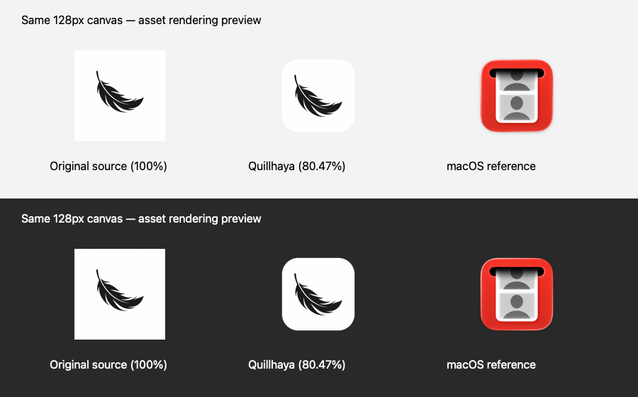

# Quillhaya 羽毛图标与 macOS 尺寸适配

日期：2026-10-29。依据用户更新的 `icon/` 及[问题截图](<../issues/Screenshot 2026-10-29 at 6.09.52 PM.png>)所示 Dock 大小问题。

## 原因与效果

旧应用图标的白色方块几乎铺满画布，缺少透明边距和圆角，因此在同样的 Dock 图标尺寸下，比邻近的 macOS 圆角图标更大。新羽毛原图也是不带 alpha 的 1254×1254 白底方图；直接转换为 ICNS 仍会保留这一问题。

现将主体放入 1024×1024 的透明画布，白色圆角底板为 824×824，四周各留 100 像素。实体宽度占画布的 80.47%，对应 64px Dock 图标约 51.5px 的白色底板。圆角半径为 184px，抗锯齿由 CoreGraphics 完成。此比例是本项目对现有 ICNS 工作流的适配参数，不将它表述为所有 Apple 图标格式的强制要求。

Apple 对图标的方形布局、圆角呈现及不同显示尺寸的设计指导见 [App icons](https://developer.apple.com/design/human-interface-guidelines/app-icons)。本项目继续使用现有 electron-builder / ICNS 流程，不需要迁移到 Icon Composer。

上图是本地素材的尺寸渲染预览，不是伪装的 Dock 截图。系统参照使用本机 Photo Booth 图标，仅用于比例对照，不进入应用安装包。实际测得其 256px 图像的非透明主体边界为 `[25, 25, 231, 231)`，宽度占比也是 80.47%；按 alpha > 127 统计。

## 技术栈与处理逻辑

- **Swift + Foundation / CoreGraphics / ImageIO**：读取原始 PNG、定位黑色羽毛范围、等比裁切、绘制圆角蒙版、输出带 alpha 的 PNG。
- **CryptoKit**：记录原图 SHA-256，便于确认生成文件使用的是哪一版原图。
- **macOS iconutil**：把全部标准尺寸及 Retina 表示组装为 ICNS。
- **npm 生命周期**：`predev`、`prebuild` 自动准备资源；开发、源码构建和安装包构建使用同一入口。
- **React / CSS、Electron、electron-builder**：分别消费同一套生成资源，用于应用界面、开发 Dock 和安装包图标。

实现入口：[prepare-icons.swift](../scripts/prepare-icons.swift)。没有新增 npm 依赖，图标脚本仅在开发/构建时使用；安装后的应用不需要 Swift 工具链。

1. 输入固定为 `icon/icon.png`，原始 PNG、用户提供的 ICNS / iconset 和 `icon_old/` 均不覆盖。
2. 读取原图像素，在白底图中识别深色羽毛边界；当前识别范围为 `[300, 279, 960, 859)`。
3. 使用原始像素做等比例裁切，不矢量描摹、不重新绘制羽毛。最长边占圆角底板的 66%，当前正方形裁切范围为 `x=130, y=69, width=1000, height=1000`，用于居中和消除多余白边。
4. 在透明画布上建立圆角蒙版，合成白色底板和裁切后的原图。外侧留白与四个角保持透明，不添加生成式阴影或毛边。
5. 从同一母版导出 16、32、64、128、256、512、1024 像素图像，按 iconset 的 10 个标准文件名保存，再调用 `iconutil`。
6. 记录处理参数、原图摘要、裁切范围和尺寸清单到 `manifest.json`。输入不是至少 1024px 的正方形白底深色图案、没有可识别深色内容或裁切空间不足时明确报错；将来更换为彩色/透明图案时应调整脚本的裁切策略。

生成式工具最初提供的两张草图因边缘质量未采用。用户已明确选择本地图像处理脚本，最终资源全部来自原始羽毛图案的确定性处理。

## 资源流向

| 场景 | 当前资源 / 处理 |
| --- | --- |
| 唯一原图 | `icon/icon.png` |
| 1024px PNG 母版 | `icon/generated/app-icon.png` |
| 标准多尺寸文件 | `icon/generated/app-icon.iconset/` |
| macOS 应用 / Finder / 打包 Dock | `icon/generated/app-icon.icns` |
| 生成记录 | `icon/generated/manifest.json` |
| 开发模式 Dock | 主进程在 ready 后加载生成 PNG |
| 启动页、启动错误页 | React 导入生成 PNG，Vite 装入本地资源 |
| 主界面左上角 | 仅显示 `Quillhaya - Writing Assistant`，按用户后续要求移除旁边的图标 |
| README 主界面截图 | 重新运行明暗主题截图用例 |

后续微调：按用户要求删除主界面左上角的图标节点及专用 CSS，保留名称文字，不留下图标占位。Dock、Finder、安装包以及启动页图标保留；启动页使用 64px 画布。正文工具按钮的功能性线条图标继续沿用既有图标库。

## 使用与验证

更换 `icon/icon.png` 后执行正常开发或构建命令即可；也可以单独执行 `npm run icons`。产物均写入 `icon/generated/`。该目录随既有 `icon/*` 忽略规则留在本地，没有修改用户的版本管理策略。

复用已有界面用例检查左上角仅显示名称，不再含图片；安装包冒烟仍比较内置 ICNS 与生成文件的实际字节，避免更改界面后遗漏系统图标资源。图标透明边距与各尺寸校验结果保留在验收记录中。

具体执行结果见 [VALIDATION.md](VALIDATION.md)。最新安装文件仍为 `dist/Quillhaya-1.0.0-arm64.dmg`。已安装或正在运行的旧应用需退出并用新安装包替换，才能显示更新资源；本次不自动覆盖 Applications 中的安装或重启用户 Dock。
