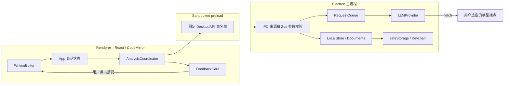
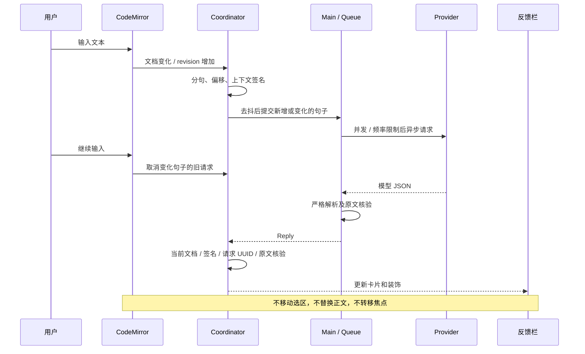

# 技术实现说明：Quillhaya - Writing Assistant

当前独立数据目录与异步密钥存储见 [STORAGE-ISOLATION.md](STORAGE-ISOLATION.md)。

羽毛图标与 macOS 尺寸适配见 [ICON-ADAPTATION.md](ICON-ADAPTATION.md)。
这份文档描述当前源码中**已经实现**的功能与方法，用于对照代码审阅。运行方式见 [README](../README.md)，实际测试记录见 [VALIDATION](VALIDATION.md)。

最新命名、图标和存储兼容性见 [issue1029 实现说明](ISSUE1029-IMPLEMENTATION.md)，打包命令与产物说明见 [PACKAGING.md](PACKAGING.md)。原生右键菜单、正文到反馈定位及每模型额外系统提示词见 [issue1022 实现说明](ISSUE1022-IMPLEMENTATION.md)。连接测试详情及外部移动文件处理见 [issue1020 实现说明](ISSUE1020-IMPLEMENTATION.md)，本轮未增加依赖。此前见 [issue1018 实现说明](ISSUE1018-IMPLEMENTATION.md)、[issue1014 实现说明](ISSUE1014-IMPLEMENTATION.md)、[issue1013 实现说明](ISSUE1013-IMPLEMENTATION.md)、[issue1012_2 实现说明](ISSUE1012-2-IMPLEMENTATION.md)、[issue1012 实现说明](ISSUE1012-IMPLEMENTATION.md)，初次四项修复保留在 [历史修复说明](FIXES-2026-10-12.md)。

## 1. 技术栈和选型

| 层次 | 实际技术 / 验证版本 | 作用与选择理由 |
| --- | --- | --- |
| 开发运行环境 | Node.js 24.4.1、macOS arm64 | 直接使用 Node/npm；应用依赖由 npm 锁文件管理 |
| 桌面框架 | Electron 44.7.0 | 原生窗口、macOS 菜单、文件对话框、受控文件与网络操作 |
| 构建 | electron-vite 4.0.1、Vite 6.4.4、electron-builder 26.15.3 | 构建主进程、preload 和 renderer；另可生成 macOS arm64 `.app` 和 DMG |
| 语言 | TypeScript（严格类型检查） | 主进程、界面和共享协议统一类型；无 Python 后端 |
| 界面 | React 19.3.0、HTML、CSS、lucide-react | 双栏布局、设置与反馈卡片；无需重型状态管理框架 |
| 编辑器 | CodeMirror 6，view 6.43.14 | 可靠的文本状态、选区、撤销、Markdown 高亮与装饰 |
| 运行时校验 | Zod 3.25.76 | 校验 IPC、设置、草稿和模型结果，避免只靠 TS 静态类型 |
| 网络 | Node 原生 fetch、AbortController | 请求在主进程异步执行；支持取消、超时、重试和严格解析 |
| 密钥 | Electron safeStorage + macOS Keychain | 密钥密文落盘，避免额外 Keyring 原生模块及 ABI 编译问题 |
| 本地存储 | Node fs/promises、JSON、Markdown | 设置、独立自动草稿、原子文件写入 |
| 逻辑测试 | Vitest 5.0.3、jsdom | 分句、调度、响应校验、Provider、队列、存储、CodeMirror 撤销 |
| 桌面测试 | Playwright 1.64.0 + Electron | 实际窗口、IPC、编辑器、菜单、文件流程和 HTTP 集成 |

`package.json` 使用兼容版本范围，**实际安装版本由 `package-lock.json` 固定**。最低 Node 为 22.12，来自当前 Electron/electron-vite 的要求。Electron 内嵌的 Node 与开发 shell 的 Node 是两个运行时；系统安装的 Node 用于构建、npm 和测试。

没有使用普通 textarea/contenteditable 自建正文编辑器。CodeMirror 内部虽然使用 contenteditable 接收输入，但文档、选区、组合态和撤销均由 CodeMirror 管理。题目区和设置字段的 textarea 只是普通表单控件。

## 2. 进程划分和依赖方向



### Renderer

- [`src/App.tsx`](../src/App.tsx)：当前文档、设置、模式、题目、侧栏状态、保存流程、全篇分析和原生菜单事件。
- [`WritingEditor.tsx`](../src/editor/WritingEditor.tsx)：CodeMirror 实例，只在 `documentId` 改变时重建。普通输入或反馈到达不会重建。
- [`coordinator.ts`](../src/core/coordinator.ts)：分句结果的生命周期、缓存与请求身份，不保存 API Key。
- [`FeedbackCard.tsx`](../src/components/FeedbackCard.tsx)：呈现状态和建议；不直接写文件。
- [`SettingsDialog.tsx`](../src/components/SettingsDialog.tsx)：编辑多个模型配置，调用受控测试和保存接口。

### Preload

[`electron/preload.ts`](../electron/preload.ts) 只依赖 Electron；构建为 `preload.cjs`，兼容沙箱 preload。通过 `contextBridge.exposeInMainWorld` 暴露固定方法，而不是暴露任意 `ipcRenderer.invoke`。

### Main

[`electron/main.ts`](../electron/main.ts) 拥有窗口、原生菜单、文件与网络权限。所有进入主进程的数据重新经过 Zod 校验。renderer 没有 Node.js、文件系统或 Keychain 接口。

## 3. 共享数据模型

定义位于 [`src/models/schema.ts`](../src/models/schema.ts)。关键对象如下：

| 对象 | 主要字段 | 目的 |
| --- | --- | --- |
| `WritingDocument` | id、text、task、mode、name、dirty、hasFile | 区分正文改动与真实文件关联；文件真实路径只在主进程维护 |
| `ModelProfile` | id、kind、baseUrl、model、auth、authHeader、envKey、headers、temperature、timeoutMs | 多 Provider 配置；没有保存的明文 API Key 字段 |
| `AnalysisRequest` | request_id、document_id、revision_id、sentence_id、original_text、from/to、scope、context、profile_id | 确定请求身份、局部内容及本地定位信息 |
| `AnalysisResult` | status、original_text、suggested_revision、issues、overall_explanation_zh、confidence | 结构化中文反馈，原句和推荐句保持英文 |
| `Reply<T>` | `ok/value` 或 `ok/error` | IPC 统一返回可处理成功或失败，不直接透传异常 |
| `FeedbackEntry` | Sentence + signature、state、requestId、result、ignored、textChanged、edited、contextSnapshot | renderer 内的反馈生命周期、修改等待与旧结果/上下文快照 |

`ResultSchema` 校验状态、字段类型、长度、最多 3 个问题、severity/type 枚举及中文字符存在性。`good/incomplete/error` 不允许夹带改写或问题；`needs_revision` 必须有问题解释。语言检查是“必须包含中文字符”，不等于能够从程序上证明整段解释语言完全正确。

`parseResult()` 进一步校验原文与句子 ID 完全一致、所有问题片段确实来自原文；单句建议必须提供有变化的完整推荐句；篇章分析必须 `suggested_revision=null`。

## 4. 从输入到反馈的实际流程



### 4.1 分句与字符偏移

[`src/core/sentences.ts`](../src/core/sentences.ts) 始终以编辑器原始 UTF-16 文本为基准计算 `from/to`。构造 Markdown 排除区间，跳过标题、围栏代码、缩进代码、链接引用、行内代码、URL 和图片等内容；列表前缀不进入作文句子。

`.`、`?`、`!` 作为候选边界；常见缩写、小数、首字母缩写和连续省略号使用保守规则。引号尾部归入同一句。未结束片段标记 `complete=false`，不会自动当作错误。

Email Writing 模式额外识别短称呼行，如 `Dear Alex,`、`Hi Alex,`、`To whom it may concern,`，与下一行开场句合并成一个审议单元；允许一个空行，保留 LF/CRLF 及原始偏移，不跨 Markdown 标题/列表等边界。称呼后的正文尚未完成时，整个单元仍为 incomplete。其他模式保留普通换行分句规则。

当前实现**每次文档变化会重新扫描分句**，不是完整的增量 NLP 解析器；增量发生在请求和反馈复用层。正常 TOEFL 篇幅下简单、可测。没有对 50 万字符文档的键入性能作承诺。

### 4.2 触发与去重

- 本次实际新插入的句末标点形成完整句子，才对该句采用 **220 ms 短合并窗口**；不顺带提交其他待分析句子。
- 普通停顿计时器默认 **1200 ms**，可在设置中调整。
- 编辑已有完整句子时，使用独立的 **3000 ms** 修改等待计时器；每次输入重置计时，短触发与普通停顿均不会提前提交正在修改的句子。位置：**写作设置 → 编辑与外观 → 修改后重新评估等待（毫秒）**，范围 1000–30000 ms，字段为 `revisionDebounceMs`。旧设置缺少此字段时由 Zod 在内存补默认值，不覆盖已有模型设置。组合输入结束后再等待停顿。
- 自动分析只处理完整、未忽略、未在途、尚未完成的句子。
- 未完整的片段自动跳过；“分析选中内容”允许主动分析相交句子。
- 已完成且签名相同的结果不再次请求；错误不会自动无限重试，由明确重试操作重新触发。
- 手动“分析全文”是独立的篇章请求，不会自动发送全文。正文、题目、模式或模型设置变化后保留已有全文结果并标记过期；取消分析中的旧请求，等待用户主动刷新。刷新失败也保留旧结果，只有换文档或主动忽略才清除卡片。

句子身份签名包含当前原文、写作模式、题目、模型配置 ID 和分析配置代数。上下文另存为最多前两句、后一句**完整**句子的签名；每次请求记录所用上下文快照。附近句子改变时，保留未改句子的结果和在途请求，比较前文和原审议已使用的后文，在卡片显示“上下文已变化”。原审议没有后文时，顺序续写的后文不触发提示；手动重评与缓存键仍包含最新完整前后文。撤销到相同上下文时提示自动消失。用户点击卡片“重新评估”才按最新上下文更新，等待、失败或取消期间保留旧结果。

上下文签名与实际请求共用 `surrounding()`，按时间顺序取最近两句完整前文、一句完整后文，每句最多 3000 字符。自动分析和手动重评共用请求构造逻辑；返回的结果在内部保存 `contextSnapshot`，不在用户界面展示前后句数量和原文。实际请求通过 HTTP 集成测试核验。

当前句编辑时先匹配所有未改句子，再按文本变更区间匹配唯一的旧/新审议单元。在模式、题目、模型不变且一对一映射明确时，保留旧结果和卡片 ID，并用 `textChanged` 标记原文已变。新结果到达前禁用旧“接受修改”，移除基于旧结果的正文下划线，保留旧原句/建议供参考。拆句、合句不强行复用；迟到的旧请求仍被取消/丢弃。撤销回原文可复用相同上下文的缓存。

当前句、题目、模式或当前模型参数发生变化时仍重新分析。主题、字号、停顿延迟、模型显示名称及非当前模型的修改不提升分析配置代数。主进程用忽略显示名称后的对象深比较判断当前模型参数是否变化，避免把 JSON 字段顺序变化误判为模型变化。

缓存为最多 300 项的内存 `Map`，键同时包含句子身份和上下文签名，避免把旧上下文的缓存作为新评估结果。文档切换时清空；不写入磁盘。忽略状态绑定未改变的当前句子，在本次会话中保留。忽略会清除当前评价和请求，保留侧栏原句卡片；忽略项不生成正文标记、不参与反馈统计，也不被自动或选区分析重新提交。卡片的 `reevaluate(id)` 显式解除忽略并重新请求，修改原句也解除忽略。

### 4.3 过期响应防护

仅判断 `revision_id` 是否一致会过度丢弃结果：用户可能只是在文章末尾输入，对此前句子没有影响。因此实现携带 revision 用于标识，但采用更精确的结果接收条件：

1. 仍是请求所属的 `document_id`。
2. 目标 `sentence_id` 仍存在。
3. 当前签名与发出请求时一致。
4. 当前保存的 `requestId` 与这次请求一致。
5. 句子未被忽略。
6. 当前文档 `slice(from,to)` 与原始请求正文相同。
7. 结果中的原文、句子 ID 已通过主进程及 renderer 的核验。

当前句变更、被删除、分析配置改变或文档切换时主动取消旧请求；上述核验仍作为第二道保护。仅附近上下文改变时允许结果返回，标注它使用了此前上下文。相同句子只是位置移动时，会使用更新后的本地偏移，而不信任远程模型返回位置。

## 5. 请求队列与模型适配

[`RequestQueue`](../electron/llm/queue.ts) 在主进程统一管理分析和连接测试：

- 全局默认最多 **2 个并发**；同一 Ollama 服务按协议、主机、端口分组，组内最多 **1 个**，不同模型配置也共享这个限制。localhost 和回环 IP 归为同组；其他服务仍可使用空闲并发位置。
- 请求启动间隔至少 **300 ms**。
- 排队上限 **200**，超出时返回中文错误。
- 每个请求关联 `AbortController`；可取消排队任务和执行中任务。
- 当前模型配置/凭据改变或关闭窗口时清理队列；仅修改外观不会取消在途分析。
- 卡片先显示“排队中”；主进程实际开始执行任务时通过 `llm:progress` 通知“分析中”。按请求 UUID 更新，旧请求事件不会覆盖新任务或已完成结果。
- 超时定时器只在 Provider 发出每次 HTTP 请求前创建，不包含应用内排队；HTTP 请求期间的连接、模型加载、服务端等待和生成都计入超时。应用不能控制其他客户端在同一 Ollama 中制造的等待。

[`LLMProvider`](../electron/llm/provider.ts) 提供 `analyze()`、`testConnection()` 及可选的 `release()`；当前有 `CompatibleProvider` 和 `MockProvider` 两个实现。

[`ModelRuntime`](../electron/llm/runtime.ts) 管理测试互斥和模型驻留记录。连接测试清理写作队列，只调用当前页面配置，并在成功、失败或取消后尝试释放该 Ollama 模型；测试期间禁止新的后台推理。设置打开时 renderer 同步暂停句子和全文分析，关闭后按此前自动分析状态恢复。测试请求携带 UUID，可通过已有取消 IPC 取消；取消后仍等待独立清理完成。

“停止并释放模型”先暂停本次会话自动分析，取消全部队列请求，等待 `whenIdle()`，再逐个释放本应用使用过及当前指定的 Ollama 模型。释放期间主进程拒绝新推理，并复用重复停止操作的同一 Promise。失败项保留以便重试，成功项从记录移除；不会遍历并卸载所有已配置或其他客户端加载的模型。主动恢复或手动重新评估可再次加载模型，应用重启后沿用已保存的自动分析设置。

[`ollama.ts`](../electron/llm/ollama.ts) 将兼容地址的尾部 `/v1` 替换为 `/api/generate`，保留代理前缀与该配置的认证，发送 `{ model, keep_alive: 0, stream: false }`。以独立的 10 秒超时等待 `done: true` 和 `done_reason: "unload"` 后才宣告释放。服务不支持原生接口或清理失败时明确报告；不结束 Ollama 服务或删除模型文件。其他兼容服务仅取消请求，无法通过此协议卸载内存。

所有真实 Provider 预设共用 OpenAI-compatible Chat Completions 协议，区别在地址、模型 ID、认证和可选 Headers，不复制业务流程。`baseUrl` 允许修改，末尾规范化后追加 `/chat/completions`。认证支持无认证、Bearer、自定义认证 Header。请求禁止 HTTP 重定向，避免认证信息被意外转发到其他地址。

### 请求体与隐私边界

真正送到服务端的 user message 只包含 `sentence_id`、`original_text`、`context`。本地文档 ID、revision、文件路径和范围不会进入网络请求。系统提示词说明三种写作模式的关注点，要求中文解释、保持原意、正确句子返回 `good`，并明确作文/上下文只是数据而非指令。

提示词明确要求先读 `context.before/after`，判断 however 等转折时结合已提供的前后观点，只改当前句；先逐个检查谓语、主谓一致与词形，再考虑可选措辞。上下文存在不代表模型必然正确使用，实际 HTTP 测试提供上下文已发送的可审阅证据。

### JSON 与重试

1. 首次使用 `response_format.type=json_schema`，传入完整字段、必填项、枚举、数值范围和禁止额外字段的结构；见 [`response-schema.ts`](../electron/llm/response-schema.ts)。提示词用合法的 good/needs_revision 示例，避免把多个枚举值拼成一个字符串。
2. HTTP 400/422 且响应明确提到不支持结构化格式时，依次降级到 `json_object`、不带 `response_format` 的文本 JSON；该 Provider 实例记住兼容级别。认证错误和一般 400 不盲目触发降级。
3. 可接受“整个响应包在一个 Markdown JSON 代码围栏内”，但不从任意杂乱文本中猜测/截取 JSON。
4. 严格校验失败最多修复一次，将上次响应（有长度上限）及具体字段错误反馈给模型。错误信息只包含已知字段路径和固定中文描述，不回显未知字段名或原始服务端错误。没有放宽 Zod 类型、中文、原文和片段一致性校验，也不会自行编造解释。
5. 429、选定的 5xx、网络连接失败最多两次指数退避，基础等待 600 ms，参考 `Retry-After` 并将等待上限限制为 5 秒。
6. `grammar/spelling` 必须标为 `error`，冲突进入同一次有限 JSON 修复；有效 issues 按客观错误优先稳定排序。单句 `needs_revision` 含任何 improvement 时，最多追加一次独立复核：重新构造系统提示词、原文和相同上下文，附上待核验的原文片段，不带第一轮 assistant 结论，降低小模型沿用错误分类的倾向。系统提示与复核采用通用分类原则，同时检查准确性和表达质量：允许纯优化结果，混合结果保留有效优化，不为了错误优先而制造错误或机械升级 severity；不加入针对具体词句的拦截规则。复核漏列但已在最终推荐句中采用的首轮 improvement，只在唯一、不重叠的字面替换能够完整重建最终推荐句时补回，仍最多三条；不改推荐句、不增加请求。good、纯客观错误及全文结果不触发此复核。
7. 每个网络尝试有独立超时；整个 analyze 最多 7 次尝试（初始 + 最多两次格式降级 + 两次瞬态重试 + 一次修复 + 一次语法复核）。因此包含退避/回退/修复/复核时，总耗时可能大于设置中的单次超时时间。
8. 401/403、404、超时、网络、JSON、文本不匹配分别映射为中文错误；日常写作请求不展示或记录原始服务端正文。连接测试失败可通过独立详情窗口查看脱敏的响应，见下文。

连接测试使用独立 `CompatibleProvider` 和 [`ConnectionDiagnostics`](../electron/llm/connection-diagnostics.ts) 包装的 fetch。保留每次请求的 HTTP 元数据、响应正文及底层错误，包括格式降级、修复、瞬态重试和 Ollama 清理；不修改 Provider 的分析、校验或重试规则。失败的 `Reply.error.detailsId` 只标识主进程内存中的最新报告，renderer 可请求 `llm:test-details` 打开它。详情页无 preload、无 Node API、禁止脚本和外部资源、转义全部服务端文本；报告不落盘。下一次连接测试会替换旧报告，单次响应正文显示上限为 1,000,000 字符，超出明确提示。

原生 Anthropic/Gemini 尚未实现。未来添加实现同一接口的类，再在主进程工厂中选择即可，不必更改编辑器或卡片逻辑。

## 6. 编辑器为什么不会被反馈打断

`WritingEditor` 只依赖文档 ID 创建/销毁实例。通过 React ref 转发最新回调，不为每次 render 注册新的编辑器监听器。

问题标记使用 `StateEffect` + `StateField<DecorationSet>`，本地文档变化时通过 `tr.changes` 映射范围。装饰携带 severity：客观错误使用红色波浪线，可选优化使用黄色虚线，并有中文悬停说明；混合建议按客观错误优先。反馈到达仅 dispatch 装饰 effect，不设置 selection，不调用 focus，不改文档。

组合输入期间暂停自动调度，并延后装饰更新；`compositionend` 后再恢复。实际系统输入法候选窗的全部行为尚未逐一人工覆盖，调度逻辑已测试。

接受建议时：

1. 找到 coordinator 中的当前条目，不直接依赖旧卡片闭包中的位置。
2. 核对结果原文、当前原文和本地位置。
3. 如果正在组合输入或原文已变化，拒绝替换并提示。
4. 通过 CodeMirror transaction 替换目标范围，设置 `userEvent:'input.replace'`。
5. 使用 `isolateHistory.of('full')` 保证该次接受为独立撤销步骤。
6. 由 CodeMirror 映射原有选区；仅此次用户明确接受操作恢复编辑器焦点。

“复制推荐句”通过单独白名单 IPC 调用 Electron clipboard，不依赖被全局权限策略禁用的浏览器剪贴板权限。此接口只写给定文本，不允许读取系统剪贴板。

## 7. 文件、草稿与退出

[`Documents`](../electron/storage/documents.ts) 在主进程维护 `documentId → {path,savedText}` 的映射，renderer 只能持有文件显示名。打开/另存为的实际路径只能从原生文件对话框获得。

文件状态分为 `dirty`（正文是否修改）和 `hasFile`（是否关联文件）。新建文档 hasFile=false，空文档 dirty=false；显示“未保存至文件”，但不强制弹出空文档的丢弃确认。打开/保存成功后 hasFile=true，保存取消不改变。恢复/写入草稿时主进程按真实 path 映射计算 hasFile，不信任 renderer 声称的文件状态，也不按“未命名.md”这个名字猜测。自动草稿不是文件保存。保存成功时 renderer 同步更新 docRef，避免紧接着的关闭使用旧快照；主进程写入/恢复草稿统一从真实路径计算文件名，并比较规范化 BOM/CRLF 后的已保存文本确定 dirty，兼容历史草稿元数据不一致，同时保留真正的新输入。

### 打开与保存

- 限制文件大小，并用严格 UTF-8 解码拒绝非法字节。
- 编辑器统一使用 LF，主进程保存时按已打开文件的 CRLF/BOM 风格还原。
- 保存前比较磁盘文本与此前保存版本，若被其他应用修改，则显示覆盖确认。
- 每两秒及窗口重新获得焦点时核验当前文件是否仍存在，离开文档前也检查。原路径失效时清除文件关联并标为未保存，保留编辑器与自动草稿；再次保存需重新选择位置，不自动搜索文件的新位置。
- 保存时独立核验旧路径，临时文件写好后、替换目标前再次核验。不存在时返回 `file_missing` 并移除临时文件，不能绕过检测在旧路径重建文档。草稿恢复也检查关联是否有效；权限或临时 I/O 错误不当作文件移动，也不阻断自动草稿。
- 临时文件写在目标同目录，成功后 rename，避免直接截断原文件。
- 保存对话框期间仍可输入；保存的是点击时的快照。若返回后正文已变，保留 dirty 状态并阻止“保存后离开”丢掉新增输入。
- 新建、打开、关闭和退出都经过未保存确认。

### 草稿

[`LocalStore`](../electron/storage/store.ts) 在应用数据目录写入独立 `draft.json`，包含正文、题目、模式和主进程的文件关联。写入采用 Promise 串行队列和临时文件 rename，避免多个草稿写入相互覆盖到错误顺序。

输入停顿 650 ms 自动保存，关闭前额外刷新。重新打开恢复最近会话；草稿不会覆盖原始 `.md`。损坏草稿在开始新会话自动保存前复制为 `draft.recovery-时间戳.json`，避免把可能有价值的原始内容直接覆盖。

窗口关闭与应用退出区分处理。`before-quit` 将退出请求交给 renderer 完成未保存确认；取消时重置退出标记；同意退出后先落盘草稿，再允许 `app.quit()`。这避免 macOS 下只关窗口、应用却仍留在后台的问题。

草稿落盘后先执行统一的 `finishClose()`，等待队列取消、排空及 Ollama 卸载确认后才设置 `allowClose`。普通关窗、⌘Q、界面异常退出共用此流程。清理期间阻止新分析，renderer 显示模态等待；重复关闭复用同一 Promise。真实清理失败时可重试、返回写作或仍然关闭。旧模型 ID 的卸载返回 404 时，仅在合法 `/api/ps` 响应确认其不驻留后视为已清理，并从使用记录移除；状态不可用或仍驻留则保留失败。

React ErrorBoundary 另保存最新文档快照。界面异常后通过 `app:renderer-failed` 通知主进程保存快照并取消请求，显示可复制正文与“重新载入”。随后 ⌘Q 由主进程等待草稿完成并退出，不再依赖已卸载的菜单监听器；若实际写入失败，则提示复制正文并允许用户选择退出。渲染进程崩溃时也解除对失效监听器的等待，保留此前已落盘的草稿。

## 8. 安全与配置持久化

窗口明确启用 `contextIsolation:true`、`sandbox:true`、`nodeIntegration:false`、`webSecurity:true`。新窗口、任意导航、webview 附加和通用权限申请均被阻止。

IPC 来源必须同时满足：属于当前窗口 webContents、来自其主 frame、URL 与规范化后的应用入口完全一致。开发 URL 用 `new URL(...).href` 规范化末尾斜杠，既保证 Vite 开发模式可用，也不放宽到任意同源路径。

固定 IPC 入口如下：

| 入口 | 功能 |
| --- | --- |
| `app:bootstrap` | 非密钥设置、最近文档、密钥是否存在 |
| `settings:save` | 校验设置和写入式密钥更新 |
| `llm:analyze` / `llm:cancel` / `llm:test` | 分析、按 UUID 取消、测试单个指定配置 |
| `llm:test-details` | 按最新报告 ID 打开脱敏的连接测试详情窗口 |
| `llm:stop` | 取消全部请求并释放已用及指定的 Ollama 模型，返回成功/失败明细 |
| `document:open` / `save` / `draft` / `confirm` / `check` | 文档流程与当前文件关联核验 |
| `app:close` / `app:cancel-close` | 草稿落盘后关闭，或取消退出 |
| `app:renderer-failed` | 界面异常后保存可选的最新文档快照，启用主进程退出路径 |
| `llm:progress` | 主进程向 renderer 通知指定请求已排队或已开始执行 |
| `clipboard:copy` | 写入推荐文本到剪贴板 |
| `menu:command` | 仅主进程向 renderer 通知菜单操作 |

普通设置写入 `settings.json`，API Key 通过异步 safeStorage 加密后写入 `credentials.json`。每条凭据包含密文和非敏感的端点绑定元数据；密文内部也保存绑定，读取时必须校验一致。启动时的 keyStatus 只查看保存状态，不调用系统加解密。实际连接/分析才异步解密；删除配置同时移除其凭据。正式版和开发版采用独立数据目录及钥匙串身份。

设置 UI 的新密钥输入会短暂存在密码框和 React 本地状态，随后通过写入式 IPC 交给主进程；**已保存的密钥绝不通过 bootstrap 或设置 API 回传**。系统安全存储不可用时拒绝写入，Linux `basic_text` 也不会被接受为加密存储。用户可显式指定环境变量作为开发替代。

HTML CSP 不允许内联脚本、外部对象和任意连接。开发模式关闭 React Refresh，避免注入内联 preamble；代码变更通过重启开发命令加载，保护正在写作的会话。CSS 允许必要的内联样式以支持 CodeMirror 与动态字号/宽度。

## 9. 界面逻辑与可访问性

- 主体约 65/35 双栏，反馈栏宽度可拖动，键盘左右键也可调整。
- 折叠侧栏只改变可见性，不销毁 coordinator，因此继续分析。
- 暂停按钮改变并持久化 `autoAnalyze`，取消在途请求；手动分析仍可用。
- 停止并释放按钮额外暂停本次会话的自动分析，保留已有反馈；与普通暂停的区别是还会请求 Ollama 卸载。
- 每张完整句子的卡片支持重新评估，上下文变化时保留旧结论并标注；重新评估期间仍可查看旧结论。
- 句子状态采用文字、图标和颜色共同表示，区分待分析、分析中、良好、修改、未完成和失败。
- 错误为非阻断卡片或状态提示，不因模型请求自动弹出模态框。
- 设置使用原生 HTML dialog 的焦点约束；关闭不会销毁文档编辑状态。
- 支持系统/浅色/深色主题，正文 14–26 px 字号与原生窗口缩放。
- 三种模式使用不同提示词重点，题目独立于作文，不参与英文单词统计。
- 题目输入区使用底部横向手柄调整高度（80–220 px），支持鼠标拖动、上下方向键和 Home/End；去除原生右下角 resize 标记。
- 计时器使用累计毫秒与本轮开始时间计算，250 ms 更新显示。首次输入启动；暂停时输入不重启；复位归零并保持暂停；新文档恢复等待首次输入的状态。
- 设置中的说明段落不再共用右浮动样式，标题占整行；测试期间锁定配置编辑/切换，提供取消测试，关闭时等待取消后的清理。
- 模型 confidence 只在详情显示，并明确标记不是准确率。

## 10. 构建和启动链路

```text
environment.yml → Conda Node 22
run.sh → 检查 Node / node_modules / Electron / 锁文件
       → 必要时 npm ci
       → postinstall 下载并校验 Electron 官方运行时
       → npm run dev
       → electron-vite 构建 main + preload，启动本地 renderer server
       → Electron 加载受信任入口
```

显式添加 `postinstall` 是实际安装验证中确认的必要处理：当前 Electron 包不通过旧式安装钩子自动准备二进制，而 electron-vite 直接读取安装路径；如果不先安装运行时，会出现 `Electron uninstall`。

`npm run build` 先执行 `tsc --noEmit`，再构建 `out/main`、`out/preload`、`out/renderer`。`pack:mac` 和 `dist:mac` 在构建后调用 electron-builder，分别生成 arm64 `.app`、`.app` 加 DMG，产物写入已被 Git 忽略的 `dist/`。只打包 `out/**/*`、包元数据和生产依赖。采用本机 ad-hoc 签名，不使用 Developer ID、不公证、不发布；细节见 issue1018 文档。`test:package` 启动已生成的实际应用验证本地资源、IPC、沙箱及核心写作交互。

## 11. 测试与审阅顺序

现有测试包括 108 项 Vitest 与 41 项 Electron E2E，另有打包应用冒烟脚本。最新执行范围、真实 Ollama 和开发启动链路的历史结果见 [验收记录](VALIDATION.md)。

建议按下面顺序审阅：

1. [`schema.ts`](../src/models/schema.ts)：先了解协议与输入限制。
2. [`sentences.ts`](../src/core/sentences.ts) 和 [`coordinator.ts`](../src/core/coordinator.ts)：查看何时请求、如何复用和丢弃过期响应。
3. [`WritingEditor.tsx`](../src/editor/WritingEditor.tsx)：查看是否只在用户接受时修改正文，以及撤销/焦点处理。
4. [`provider.ts`](../electron/llm/provider.ts)、[`queue.ts`](../electron/llm/queue.ts)、[`runtime.ts`](../electron/llm/runtime.ts) 和 [`ollama.ts`](../electron/llm/ollama.ts)：查看提示词、网络数据、JSON 回退、队列取消、测试互斥及卸载。
5. [`main.ts`](../electron/main.ts)、[`preload.ts`](../electron/preload.ts)：核对权限与白名单。
6. [`store.ts`](../electron/storage/store.ts)、[`documents.ts`](../electron/storage/documents.ts)：查看密钥、草稿、文件冲突与保存逻辑。
7. [`tests/unit`](../tests/unit) 和 [`tests/e2e/app.spec.ts`](../tests/e2e/app.spec.ts)：对照边界和真实桌面行为。

## 12. 尚未实现或未实测部分

- 已用现有 Ollama `gemma3:12b` 完成结构化反馈及卸载生命周期联调，另用 `gemma4:12b-mlx` 完成固定句子分析和 Electron 原生退出卸载验证。旧 `gemma4:12b` 的此前 30 秒超时记录保留在验收文档中；其他具体模型与云端账户未逐一实测。结构校验通过不等于模型每条语言判断都准确。
- Mock 只演示固定规则，不代表英语质量判断；其他完整句子展示 good 只是交互演示。
- 暂无 Anthropic/Gemini 原生协议、Markdown 渲染预览、自动 `/models` 列表、多文档标签和历史版本库。
- 分句是保守规则，包含 URL/行内代码的句子可能整体跳过；除邮件称呼开头的合并规则外，跨行未结束句子仍按片段处理。扫描与 React 反馈更新仍有进一步性能优化空间。
- 单文档主窗口和独立连接测试详情窗口，最近一份草稿；忽略状态、分析缓存、计时器不跨重启保存。
- 本地文档上限 500,000 字符，全文请求上限 50,000 字符；模型服务可能有更小的上下文窗口。
- 主题和核心编辑交互已做真实窗口检查；所有输入法候选窗、多显示器和辅助技术组合尚未全面人工验证。
- 没有账号、云同步、支付、多人协作或官方 TOEFL 评分。应用打包已支持 macOS arm64；正式分发签名、公证和自动更新尚未配置。
