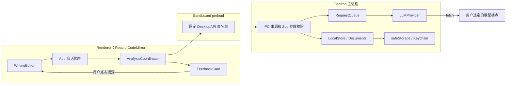
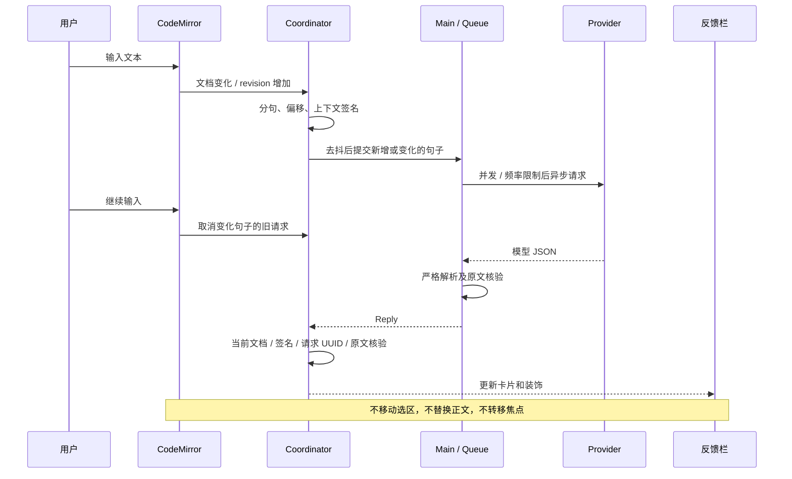

# 技术实现说明：TOEFL Writing Assistant

这份文档描述当前源码中**已经实现**的功能与方法，用于对照代码审阅。运行方式见 [README](../README.md)，实际测试记录见 [VALIDATION](VALIDATION.md)。

## 1. 技术栈和选型

| 层次 | 实际技术 / 验证版本 | 作用与选择理由 |
| --- | --- | --- |
| 开发运行环境 | Conda、Node.js 22.23.2、macOS arm64 | Conda 只负责 Node 环境；所有应用依赖由 npm 锁文件管理 |
| 桌面框架 | Electron 44.7.0 | 原生窗口、macOS 菜单、文件对话框、受控文件与网络操作 |
| 构建 | electron-vite 4.0.1、Vite 6.4.4 | 分别构建主进程、preload 和 renderer；不做应用打包 |
| 语言 | TypeScript（严格类型检查） | 主进程、界面和共享协议统一类型；无 Python 后端 |
| 界面 | React 19.3.0、HTML、CSS、lucide-react | 双栏布局、设置与反馈卡片；无需重型状态管理框架 |
| 编辑器 | CodeMirror 6，view 6.43.14 | 可靠的文本状态、选区、撤销、Markdown 高亮与装饰 |
| 运行时校验 | Zod 3.25.76 | 校验 IPC、设置、草稿和模型结果，避免只靠 TS 静态类型 |
| 网络 | Node 原生 fetch、AbortController | 请求在主进程异步执行；支持取消、超时、重试和严格解析 |
| 密钥 | Electron safeStorage + macOS Keychain | 密钥密文落盘，避免额外 Keyring 原生模块及 ABI 编译问题 |
| 本地存储 | Node fs/promises、JSON、Markdown | 设置、独立自动草稿、原子文件写入 |
| 逻辑测试 | Vitest 5.0.3、jsdom | 分句、调度、响应校验、Provider、队列、存储、CodeMirror 撤销 |
| 桌面测试 | Playwright 1.64.0 + Electron | 实际窗口、IPC、编辑器、菜单、文件流程和 HTTP 集成 |

`package.json` 使用兼容版本范围，**实际安装版本由 `package-lock.json` 固定**。最低 Node 为 22.12，来自当前 Electron/electron-vite 的要求。Electron 内嵌的 Node 与开发 shell 的 Node 是两个运行时；Conda 提供的是构建、npm 和测试所用的 Node。

没有使用普通 textarea/contenteditable 自建正文编辑器。CodeMirror 内部虽然使用 contenteditable 接收输入，但文档、选区、组合态和撤销均由 CodeMirror 管理。题目区和设置字段的 textarea 只是普通表单控件。

## 2. 进程划分和依赖方向



### Renderer

- [`src/App.tsx`](../src/App.tsx)：当前文档、设置、模式、题目、侧栏状态、保存流程、全篇分析和原生菜单事件。
- [`WritingEditor.tsx`](../src/editor/WritingEditor.tsx)：CodeMirror 实例，只在 `documentId` 改变时重建。普通输入或反馈到达不会重建。
- [`coordinator.ts`](../src/core/coordinator.ts)：分句结果的生命周期、缓存与请求身份，不保存 API Key。
- [`FeedbackCard.tsx`](../src/components/FeedbackCard.tsx)：呈现状态和建议；不直接写文件。
- [`SettingsDialog.tsx`](../src/components/SettingsDialog.tsx)：编辑多个模型配置，调用受控测试和保存接口。

### Preload

[`electron/preload.ts`](../electron/preload.ts) 只依赖 Electron；构建为 `preload.cjs`，兼容沙箱 preload。通过 `contextBridge.exposeInMainWorld` 暴露固定方法，而不是暴露任意 `ipcRenderer.invoke`。

### Main

[`electron/main.ts`](../electron/main.ts) 拥有窗口、原生菜单、文件与网络权限。所有进入主进程的数据重新经过 Zod 校验。renderer 没有 Node.js、文件系统或 Keychain 接口。

## 3. 共享数据模型

定义位于 [`src/models/schema.ts`](../src/models/schema.ts)。关键对象如下：

| 对象 | 主要字段 | 目的 |
| --- | --- | --- |
| `WritingDocument` | id、text、task、mode、name、dirty | 管理作文与独立题目；文件真实路径只在主进程维护 |
| `ModelProfile` | id、kind、baseUrl、model、auth、authHeader、envKey、headers、temperature、timeoutMs | 多 Provider 配置；没有保存的明文 API Key 字段 |
| `AnalysisRequest` | request_id、document_id、revision_id、sentence_id、original_text、from/to、scope、context、profile_id | 确定请求身份、局部内容及本地定位信息 |
| `AnalysisResult` | status、original_text、suggested_revision、issues、overall_explanation_zh、confidence | 结构化中文反馈，原句和推荐句保持英文 |
| `Reply<T>` | `ok/value` 或 `ok/error` | IPC 统一返回可处理成功或失败，不直接透传异常 |
| `FeedbackEntry` | Sentence + signature、state、requestId、result、ignored | renderer 内的反馈生命周期 |

`ResultSchema` 校验状态、字段类型、长度、最多 3 个问题、severity/type 枚举及中文字符存在性。`good/incomplete/error` 不允许夹带改写或问题；`needs_revision` 必须有问题解释。语言检查是“必须包含中文字符”，不等于能够从程序上证明整段解释语言完全正确。

`parseResult()` 进一步校验原文与句子 ID 完全一致、所有问题片段确实来自原文；单句建议必须提供有变化的完整推荐句；篇章分析必须 `suggested_revision=null`。

## 4. 从输入到反馈的实际流程



### 4.1 分句与字符偏移

[`src/core/sentences.ts`](../src/core/sentences.ts) 始终以编辑器原始 UTF-16 文本为基准计算 `from/to`。构造 Markdown 排除区间，跳过标题、围栏代码、缩进代码、链接引用、行内代码、URL 和图片等内容；列表前缀不进入作文句子。

`.`、`?`、`!` 作为候选边界；常见缩写、小数、首字母缩写和连续省略号使用保守规则。引号尾部归入同一句。未结束片段标记 `complete=false`，不会自动当作错误。

当前实现**每次文档变化会重新扫描分句**，不是完整的增量 NLP 解析器；增量发生在请求和反馈复用层。正常 TOEFL 篇幅下简单、可测。没有对 50 万字符文档的键入性能作承诺。

### 4.2 触发与去重

- 完整标点采用 **220 ms 短合并窗口**，避免同一阵输入逐键请求。
- 停顿计时器默认 **1200 ms**，可在设置中调整。
- 自动分析只处理完整、未忽略、未在途、尚未完成的句子。
- 未完整的片段自动跳过；“分析选中内容”允许主动分析相交句子。
- 已完成且签名相同的结果不再次请求；错误不会自动无限重试，由明确重试操作重新触发。
- 手动“分析全文”是独立的篇章请求，不会自动发送全文。

签名包含：当前句子、最多前两句和后一句**完整**上下文、写作模式、题目、模型配置 ID 和配置代数。相邻句子完成或改动可能影响当前句子的上下文，此时允许重新分析。

缓存为最多 300 项的内存 `Map`。文档切换时清空；不写入磁盘。忽略状态绑定未改变的当前句子，在本次会话中保留。

### 4.3 过期响应防护

仅判断 `revision_id` 是否一致会过度丢弃结果：用户可能只是在文章末尾输入，对此前句子没有影响。因此实现携带 revision 用于标识，但采用更精确的结果接收条件：

1. 仍是请求所属的 `document_id`。
2. 目标 `sentence_id` 仍存在。
3. 当前签名与发出请求时一致。
4. 当前保存的 `requestId` 与这次请求一致。
5. 句子未被忽略。
6. 当前文档 `slice(from,to)` 与原始请求正文相同。
7. 结果中的原文、句子 ID 已通过主进程及 renderer 的核验。

句子变更、被删除、上下文变化或文档切换时主动取消旧请求；上述核验仍作为第二道保护。相同句子只是位置移动时，会使用更新后的本地偏移，而不信任远程模型返回位置。

## 5. 请求队列与模型适配

[`RequestQueue`](../electron/llm/queue.ts) 在主进程统一管理分析和连接测试：

- 默认最多 **2 个并发**。
- 请求启动间隔至少 **300 ms**。
- 排队上限 **200**，超出时返回中文错误。
- 每个请求关联 `AbortController`；可取消排队任务和执行中任务。
- 切换配置或关闭窗口时清理队列。

[`LLMProvider`](../electron/llm/provider.ts) 提供 `analyze()` 与 `testConnection()`；当前有 `CompatibleProvider` 和 `MockProvider` 两个实现。

所有真实 Provider 预设共用 OpenAI-compatible Chat Completions 协议，区别在地址、模型 ID、认证和可选 Headers，不复制业务流程。`baseUrl` 允许修改，末尾规范化后追加 `/chat/completions`。认证支持无认证、Bearer、自定义认证 Header。请求禁止 HTTP 重定向，避免认证信息被意外转发到其他地址。

### 请求体与隐私边界

真正送到服务端的 user message 只包含 `sentence_id`、`original_text`、`context`。本地文档 ID、revision、文件路径和范围不会进入网络请求。系统提示词说明三种写作模式的关注点，要求中文解释、保持原意、正确句子返回 `good`，并明确作文/上下文只是数据而非指令。

### JSON 与重试

1. 首次使用 `response_format: {type:'json_object'}`，兼顾各类兼容服务。
2. HTTP 400/422 且响应明确提到不支持结构化格式时，移除 `response_format` 重试；该 Provider 实例记住回退状态。
3. 可接受“整个响应包在一个 Markdown JSON 代码围栏内”，但不从任意杂乱文本中猜测/截取 JSON。
4. 严格校验失败最多追加一次修复指令；不把未经校验的结果呈现为有效建议。
5. 429、选定的 5xx、网络连接失败最多两次指数退避，基础等待 600 ms，参考 `Retry-After` 并将等待上限限制为 5 秒。
6. 每个网络尝试有独立超时；整个 analyze 最多 5 次尝试。因此包含退避/回退/修复时，总耗时可能大于设置中的单次超时时间。
7. 401/403、404、超时、网络、JSON、文本不匹配分别映射为中文错误；原始服务端错误正文不会直接显示或记录。

原生 Anthropic/Gemini 尚未实现。未来添加实现同一接口的类，再在主进程工厂中选择即可，不必更改编辑器或卡片逻辑。

## 6. 编辑器为什么不会被反馈打断

`WritingEditor` 只依赖文档 ID 创建/销毁实例。通过 React ref 转发最新回调，不为每次 render 注册新的编辑器监听器。

问题标记使用 `StateEffect` + `StateField<DecorationSet>`，本地文档变化时通过 `tr.changes` 映射范围。反馈到达仅 dispatch 装饰 effect，不设置 selection，不调用 focus，不改文档。

组合输入期间暂停自动调度，并延后装饰更新；`compositionend` 后再恢复。实际系统输入法候选窗的全部行为尚未逐一人工覆盖，调度逻辑已测试。

接受建议时：

1. 找到 coordinator 中的当前条目，不直接依赖旧卡片闭包中的位置。
2. 核对结果原文、当前原文和本地位置。
3. 如果正在组合输入或原文已变化，拒绝替换并提示。
4. 通过 CodeMirror transaction 替换目标范围，设置 `userEvent:'input.replace'`。
5. 使用 `isolateHistory.of('full')` 保证该次接受为独立撤销步骤。
6. 由 CodeMirror 映射原有选区；仅此次用户明确接受操作恢复编辑器焦点。

“复制推荐句”通过单独白名单 IPC 调用 Electron clipboard，不依赖被全局权限策略禁用的浏览器剪贴板权限。此接口只写给定文本，不允许读取系统剪贴板。

## 7. 文件、草稿与退出

[`Documents`](../electron/storage/documents.ts) 在主进程维护 `documentId → {path,savedText}` 的映射，renderer 只能持有文件显示名。打开/另存为的实际路径只能从原生文件对话框获得。

### 打开与保存

- 限制文件大小，并用严格 UTF-8 解码拒绝非法字节。
- 编辑器统一使用 LF，主进程保存时按已打开文件的 CRLF/BOM 风格还原。
- 保存前比较磁盘文本与此前保存版本，若被其他应用修改，则显示覆盖确认。
- 临时文件写在目标同目录，成功后 rename，避免直接截断原文件。
- 保存对话框期间仍可输入；保存的是点击时的快照。若返回后正文已变，保留 dirty 状态并阻止“保存后离开”丢掉新增输入。
- 新建、打开、关闭和退出都经过未保存确认。

### 草稿

[`LocalStore`](../electron/storage/store.ts) 在应用数据目录写入独立 `draft.json`，包含正文、题目、模式和主进程的文件关联。写入采用 Promise 串行队列和临时文件 rename，避免多个草稿写入相互覆盖到错误顺序。

输入停顿 650 ms 自动保存，关闭前额外刷新。重新打开恢复最近会话；草稿不会覆盖原始 `.md`。损坏草稿在开始新会话自动保存前复制为 `draft.recovery-时间戳.json`，避免把可能有价值的原始内容直接覆盖。

窗口关闭与应用退出区分处理。`before-quit` 将退出请求交给 renderer 完成未保存确认；取消时重置退出标记；同意退出后先落盘草稿，再允许 `app.quit()`。这避免 macOS 下只关窗口、应用却仍留在后台的问题。

## 8. 安全与配置持久化

窗口明确启用 `contextIsolation:true`、`sandbox:true`、`nodeIntegration:false`、`webSecurity:true`。新窗口、任意导航、webview 附加和通用权限申请均被阻止。

IPC 来源必须同时满足：属于当前窗口 webContents、来自其主 frame、URL 与规范化后的应用入口完全一致。开发 URL 用 `new URL(...).href` 规范化末尾斜杠，既保证 Vite 开发模式可用，也不放宽到任意同源路径。

固定 IPC 入口如下：

| 入口 | 功能 |
| --- | --- |
| `app:bootstrap` | 非密钥设置、最近文档、密钥是否存在 |
| `settings:save` | 校验设置和写入式密钥更新 |
| `llm:analyze` / `llm:cancel` / `llm:test` | 分析、取消、连接测试 |
| `document:open` / `save` / `draft` / `confirm` | 文档流程 |
| `app:close` / `app:cancel-close` | 草稿落盘后关闭，或取消退出 |
| `clipboard:copy` | 写入推荐文本到剪贴板 |
| `menu:command` | 仅主进程向 renderer 通知菜单操作 |

普通设置写入 `settings.json`，密钥写入 `credentials.json` 的加密字符串。加密 payload 包含配置 ID 对应的目标地址、认证方式和认证 Header；读取时验证目标仍一致。删除配置同时移除其凭据。

设置 UI 的新密钥输入会短暂存在密码框和 React 本地状态，随后通过写入式 IPC 交给主进程；**已保存的密钥绝不通过 bootstrap 或设置 API 回传**。系统安全存储不可用时拒绝写入，Linux `basic_text` 也不会被接受为加密存储。用户可显式指定环境变量作为开发替代。

HTML CSP 不允许内联脚本、外部对象和任意连接。开发模式关闭 React Refresh，避免注入内联 preamble；代码变更通过重启开发命令加载，保护正在写作的会话。CSS 允许必要的内联样式以支持 CodeMirror 与动态字号/宽度。

## 9. 界面逻辑与可访问性

- 主体约 65/35 双栏，反馈栏宽度可拖动，键盘左右键也可调整。
- 折叠侧栏只改变可见性，不销毁 coordinator，因此继续分析。
- 暂停按钮改变并持久化 `autoAnalyze`，取消在途请求；手动分析仍可用。
- 句子状态采用文字、图标和颜色共同表示，区分待分析、分析中、良好、修改、未完成和失败。
- 错误为非阻断卡片或状态提示，不因模型请求自动弹出模态框。
- 设置使用原生 HTML dialog 的焦点约束；关闭不会销毁文档编辑状态。
- 支持系统/浅色/深色主题，正文 14–26 px 字号与原生窗口缩放。
- 三种模式使用不同提示词重点，题目独立于作文，不参与英文单词统计。
- 模型 confidence 只在详情显示，并明确标记不是准确率。

## 10. 构建和启动链路

```text
environment.yml → Conda Node 22
run.sh → 检查 Node / node_modules / Electron / 锁文件
       → 必要时 npm ci
       → postinstall 下载并校验 Electron 官方运行时
       → npm run dev
       → electron-vite 构建 main + preload，启动本地 renderer server
       → Electron 加载受信任入口
```

显式添加 `postinstall` 是实际安装验证中确认的必要处理：当前 Electron 包不通过旧式安装钩子自动准备二进制，而 electron-vite 直接读取安装路径；如果不先安装运行时，会出现 `Electron uninstall`。

`npm run build` 先执行 `tsc --noEmit`，再构建 `out/main`、`out/preload`、`out/renderer`。项目没有 electron-builder、签名、公证或分发脚本。

## 11. 测试与审阅顺序

已通过 46 项 Vitest 测试与 12 项 Electron E2E，并实际跑通 Conda Node 22 下的 `run.sh` 开发链路。详细命令、环境与范围见 [验收记录](VALIDATION.md)。

建议按下面顺序审阅：

1. [`schema.ts`](../src/models/schema.ts)：先了解协议与输入限制。
2. [`sentences.ts`](../src/core/sentences.ts) 和 [`coordinator.ts`](../src/core/coordinator.ts)：查看何时请求、如何复用和丢弃过期响应。
3. [`WritingEditor.tsx`](../src/editor/WritingEditor.tsx)：查看是否只在用户接受时修改正文，以及撤销/焦点处理。
4. [`provider.ts`](../electron/llm/provider.ts) 和 [`queue.ts`](../electron/llm/queue.ts)：查看提示词、网络数据、JSON 回退、重试及取消。
5. [`main.ts`](../electron/main.ts)、[`preload.ts`](../electron/preload.ts)：核对权限与白名单。
6. [`store.ts`](../electron/storage/store.ts)、[`documents.ts`](../electron/storage/documents.ts)：查看密钥、草稿、文件冲突与保存逻辑。
7. [`tests/unit`](../tests/unit) 和 [`tests/e2e/app.spec.ts`](../tests/e2e/app.spec.ts)：对照边界和真实桌面行为。

## 12. 尚未实现或未实测部分

- 真实云端账户与具体本地模型尚未逐一联调；当前验证的是统一兼容协议、真实本地 HTTP 和确定性 Mock，不能据此宣称所有服务/模型都已实测。
- Mock 只演示固定规则，不代表英语质量判断；其他完整句子展示 good 只是交互演示。
- 暂无 Anthropic/Gemini 原生协议、Markdown 渲染预览、自动 `/models` 列表、多文档标签和历史版本库。
- 分句是保守规则，包含 URL/行内代码的句子可能整体跳过，跨行未结束句子暂按片段处理。扫描与 React 反馈更新仍有进一步性能优化空间。
- 单窗口、最近一份草稿；忽略状态、分析缓存、计时器不跨重启保存。
- 本地文档上限 500,000 字符，全文请求上限 50,000 字符；模型服务可能有更小的上下文窗口。
- 主题和核心编辑交互已做真实窗口检查；所有输入法候选窗、多显示器和辅助技术组合尚未全面人工验证。
- 没有账号、云同步、支付、多人协作、官方 TOEFL 评分或应用打包。
