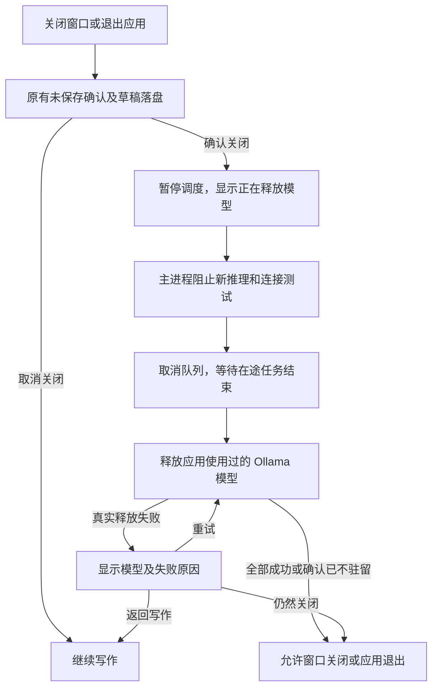

# issue1012_2：输入调度、正文标记与退出清理

日期：2026-10-12。对应 [issue/issue1012_2.md](../issues/issue1012_2.md) 的四项问题。本次继续使用 Electron + React + TypeScript + CodeMirror + Zod + Node fetch，没有新增运行时依赖，没有修改用户实际设置、凭据或作文。

> 本文保留当时的实现与验收记录。2026-10-13 已将“修改已有句子”的默认等待改为独立 3000 ms，并保留修改中的旧反馈；设置位置与当前规则见 [issue1013 实现说明](ISSUE1013-IMPLEMENTATION.md)。下文的默认 1200 ms 为历史行为。

## 1. 修改已有句子时等待停顿

**根因**：调度器原先在每次更新后都启动 220 ms 定时器，并扫描全部待分析句子。修改句中内容时，原句末尾的句号仍在，因此一个超过 220 ms 的键入间隔就会触发模型；设置的默认 1200 ms 停顿延迟实际上被更短的定时器抢先执行。

**现在的规则**：

| 情况 | 自动分析时机 |
| --- | --- |
| 修改已有完整句子的内部内容，句末标点未变 | 等待设置中的完整停顿延迟，默认 1200 ms |
| 期间继续输入、删除或替换 | 重新计算停顿时间；原句已变的在途请求仍立即取消 |
| 本次新插入句末 `.?!` 并形成完整句子 | 220 ms 合并窗口后，仅提交这次新完成的句子 |
| 另一个句子刚完成 | 不顺带提前提交仍在修改的句子 |
| 输入法组合期间 | 不自动提交；组合结束后等待停顿 |
| 手动重新评估或分析选区 | 按用户操作立即提交 |

实现比较前后文本的公共前缀/后缀，找出本次实际插入/替换区间。完整句子的终止标点必须落在新区间内，才加入短触发列表。短触发按句子 ID 调用，不再扫描所有 pending 条目；停顿触发仍处理符合条件的待分析句子。分句规则继续排除缩写、小数等不构成句子终止的位置。

“修改完成”通过用户可配置的停顿时间判断；应用无法推断思考过程。若希望更长的思考间隔，可增加“停顿延迟”，或暂停自动分析后手动重新评估。此前确认的“邻句反馈保留、手动更新”规则继续生效。

代码：[coordinator.ts](../src/core/coordinator.ts)。

## 2. 两类正文标记

旧正文装饰只接收 `from/to`，所有建议使用同一个黄色下划线。现在装饰增加 `severity`，由审议结果的 issues 计算：

- 存在 `severity: error`：**红色波浪线**，悬停提示“客观错误 · 建议修改”。
- 全部为 `severity: improvement`：**黄色虚线**，悬停提示“可选优化 · 可按需采纳”。
- 同一句同时包含两类建议：按客观错误优先；卡片详情保留每条建议的类型。
- 表达良好、不完整、分析失败或已忽略的句子，不新增建议下划线。

颜色使用现有浅色/深色主题变量，线型也不同，避免只靠颜色区分。装饰沿用 CodeMirror 的 StateEffect/StateField 和范围映射，不替换正文、不移动光标或更改撤销栈。重新评估时若仍展示旧反馈，相应标记也保留。

代码：[App.tsx](../src/App.tsx)、[WritingEditor.tsx](../src/editor/WritingEditor.tsx)、[app.css](../src/styles/app.css)。

实际截图：[浅色](issue1012-2-marks-light.png)、[深色](issue1012-2-marks-dark.png)，均已查看。

## 3. 关闭应用时等待模型释放

**根因**：原 `app:close` 和界面异常退出分支只调用 `queue.clear()`，随后允许窗口/进程结束。中断 HTTP 请求并不等于 Ollama 卸载模型。

现在普通关窗、原生 ⌘Q、界面异常恢复后的退出共用 `finishClose()`：



关闭过程复用同一 Promise，重复点击关闭不会重复创建清理任务。卸载请求沿用独立 10 秒超时；已取消的推理不会同时取消清理。renderer 等待期间显示模态状态，避免用户在草稿保存后继续输入而丢失最后的修改。返回写作时解除界面等待，保留旧反馈，自动分析保持暂停，方便重试释放。

界面失败时主进程仍能先保存恢复快照，再执行同一清理流程，不依赖已经失效的 React 菜单监听器。未保存确认中选择取消，不会提前卸载正在使用的模型。

退出只处理本应用跟踪的模型，不扫描并停止其他应用的模型，不结束 Ollama 服务、不删除模型文件。操作系统强制结束进程、断电或服务本身不可达，仍无法保证执行卸载；清理失败会明确显示，不能静默声称成功。

代码：[Electron main.ts](../electron/main.ts)、[runtime.ts](../electron/llm/runtime.ts)、[queue.ts](../electron/llm/queue.ts)、[App.tsx](../src/App.tsx)。

## 4. 模型 ID 更改后的 404

本次只读检查确认：实际 `Model` 字段已改为 `gemma4:12b-mlx`，本机模型列表中有此新 ID，但没有旧的 `gemma4:12b`。这与仅修改显示用的“配置名称”不同。

应用会保存使用过的模型 ID，以便释放前一个模型。因此同一会话中切换 ID 后，停止会分别清理旧 ID 和新 ID。旧模型已删除/改名时，对旧 ID 的 `/api/generate` 请求会返回 404；此前将它直接记作释放失败，即使新模型已经正常卸载，也显示错误。

现在保持正常卸载协议，只在返回 404 时增加核验：

1. 使用相同服务地址、代理路径前缀与认证，请求 `GET /api/ps`。
2. 严格校验响应中存在合法的 `models` 数组以及模型名称字段。
3. 若确认旧模型不在驻留列表：记为 `alreadyReleased`，提示“确认已不驻留”，从历史使用记录移除。
4. 若模型仍在内存，或状态接口失败/数据不合法：仍返回真实释放错误，不吞掉 404。
5. 继续释放其他模型，分别报告实际卸载、已不驻留及失败结果。

模型名称比较兼容省略 `:latest` 的写法；状态核验与卸载共用一次独立 10 秒清理期限，避免回退检查无限等待。并未把所有 404 当作成功，也不发送旧模型的推理请求。

协议依据：[Ollama 运行中模型列表](https://docs.ollama.com/api/ps)、[Ollama Generate API](https://docs.ollama.com/api/generate)。

代码：[ollama.ts](../electron/llm/ollama.ts)、[runtime.ts](../electron/llm/runtime.ts)、[schema.ts](../src/models/schema.ts)、[App.tsx](../src/App.tsx)。

## 5. 验证与复现

| 验证 | 本次结果 |
| --- | --- |
| Conda Node 22.23.2：`npm run check` | 类型检查、79 项单元测试（8 个文件）和生产构建通过 |
| Conda Node 22.23.2：完整 Playwright Electron 测试 | 29 项通过，约 1.1 分钟 |
| Conda Node 22.23.2：开发启动冒烟 | `bash run.sh → Vite → sandboxed Electron → Mock 反馈 → 接受修改` 通过 |
| 真实 `gemma4:12b-mlx` + Electron 原生退出 | 固定句子分析通过；退出前 `/api/ps` 确认模型驻留，退出后确认已卸载；总计 28.326 秒，保留当前配置的 120 秒超时 |
| 真实旧 ID `gemma4:12b` | 经主进程停止 IPC 和 `/api/ps` 确认为已不驻留，返回 `alreadyReleased`，未误报释放失败 |
| 浅色/深色装饰 | 真实窗口检查红色波浪线、黄色虚线、悬停说明，忽略后清除对应装饰 |

新增 11 项单元测试覆盖连续修改、不同句子触发隔离、主动重评、旧模型记录移除、404 后的驻留/不存在/状态不可用/非法数据及认证路径。新增 7 项 E2E 验证上述四项功能，包括关窗、⌘Q、恢复退出三条路径，以及失败后返回写作重试。测试用本地 HTTP 服务模拟延迟卸载，确认应用收到卸载确认前仍保持运行，排队中的后续句子不会再提交。

首次新增 E2E 为 6/7：状态文字前带有“·”图标，严格全文断言未匹配；请求记录已确认连续键入没有额外请求。修正为匹配状态文案后，完整 29 项通过。

### 可复验命令

```bash
conda activate toefl-writing-assistant
npm run check
npm run test:e2e
npm run test:dev

# 可选：使用当前本机无认证 Ollama，隔离 Electron 用户目录，发送固定测试句
# 会加载测试模型，随后通过原生退出验证卸载；不读作文/凭据，不改真实配置
npm run test:ollama:close

# 可指定已保存的配置 ID，以及一个已不驻留的历史模型 ID
TWA_OLLAMA_PROFILE=<配置ID> TWA_OLLAMA_OLD_MODEL=<旧模型ID> npm run test:ollama:close
```

`ollama-close-smoke.mjs` 启动前检查指定模型是否已驻留；若已被其他会话使用则停止检查，避免打断现有推理。先验证固定句子的分析结果，再确认 `/api/ps` 中模型已加载，最后调用真正的 Electron `app.quit()` 并确认模型不再驻留。清理失败不会通过最后的驻留断言。

本次实际执行使用已有配置 `a7fbbff2-eb4c-4d5e-adee-3a910e1fb44d` 和历史模型 ID `gemma4:12b`。当时该配置的实际模型为 `gemma4:12b-mlx`、超时为 120000 ms；没有调整这些值，也没有切换用户真实的默认配置。

完整历史记录见 [VALIDATION.md](VALIDATION.md)。重新运行 `bash run.sh` 加载本轮 main/preload/renderer 改动。
