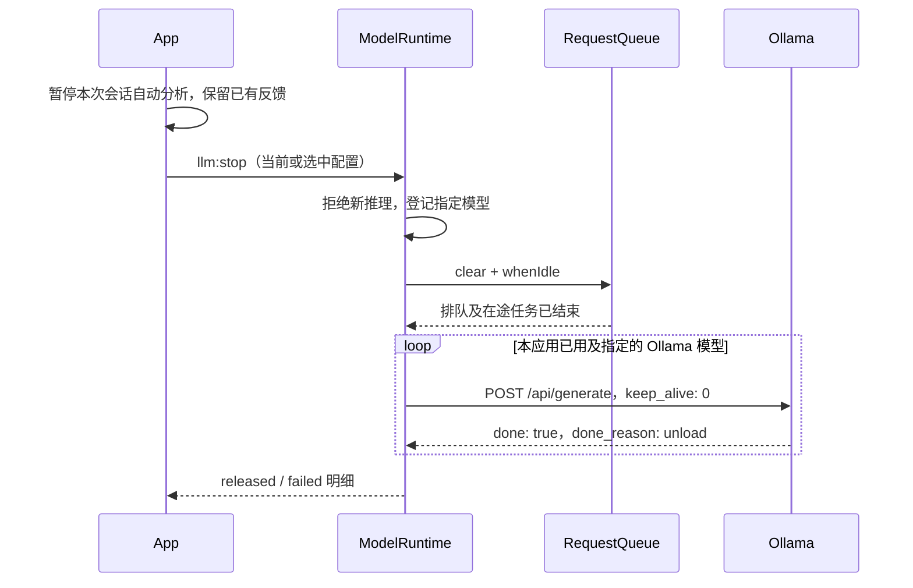

# issue1012：具体实现与验收记录

> 后续 [issue1012_2](ISSUE1012-2-IMPLEMENTATION.md) 补充了句中编辑的完整停顿等待、分级正文标记、退出时清理，以及旧模型 ID 的 404 驻留核验。本文保留该轮实现及测试记录。

日期：2026-10-12。对应 [原始问题](../issues/issue1012.md) 的六项要求。第 4 项按用户确认采用“保留反馈，手动重新评估”。本次没有增加运行时依赖，没有修改用户实际的模型配置、凭据或作文。

## 1. 技术栈

| 层次 | 技术 | 本次职责 |
| --- | --- | --- |
| 开发环境 | Conda Node.js 22.23.2、macOS arm64 | 构建和测试；不需要 Python 后端 |
| 桌面层 | Electron 44.7.0 | 主进程请求、固定 IPC、窗口与本地配置 |
| UI | React 19.3.0、TypeScript 5.9.3、CSS、lucide-react | 设置布局、拖动手柄、计时器、反馈状态及停止按钮 |
| 正文编辑 | CodeMirror 6 | 继续沿用文档、光标、撤销及建议接受逻辑 |
| 数据约束 | Zod 3.25.76 | 保留模型字段、中文解释、类型和原文校验；校验新增 IPC 参数 |
| 网络与生命周期 | Node fetch、AbortController、Ollama 原生 API | 推理取消、队列排空、单模型测试与卸载确认 |
| 构建 | electron-vite 4.0.1、Vite 6.4.4 | main、sandboxed preload、renderer 分别构建 |
| 验证 | Vitest 5.0.3、jsdom、Playwright 1.64.0 | 逻辑边界、真实 Electron 窗口、本地 HTTP 与真实 Ollama |

依赖版本仍由现有 `package-lock.json` 固定。完整架构见 [IMPLEMENTATION.md](IMPLEMENTATION.md)。

## 2. 六项问题与实现位置

| 问题 | 现在的行为 | 主要代码 |
| --- | --- | --- |
| “编辑与外观”竖排 | 标题占完整一行，说明段落不挤占后续布局 | [settings.css](../src/styles/settings.css) |
| 题目区原生缩放角外观 | 底部居中横向手柄，可拖动及键盘调节高度 | [TaskContextInput.tsx](../src/components/TaskContextInput.tsx)、[app.css](../src/styles/app.css) |
| 计时器缺少控制 | 右侧增加暂停/继续、复位；暂停时输入不自动续计 | [useWritingTimer.ts](../src/core/useWritingTimer.ts)、[App.tsx](../src/App.tsx) |
| 修改一句导致相邻反馈丢失 | 保留未改句子反馈，标注上下文变化，逐卡片手动重新评估 | [coordinator.ts](../src/core/coordinator.ts)、[FeedbackCard.tsx](../src/components/FeedbackCard.tsx) |
| 模型长期驻留、测试后不释放 | 停止全部应用请求并卸载已用模型；测试后自动清理测试模型 | [runtime.ts](../electron/llm/runtime.ts)、[ollama.ts](../electron/llm/ollama.ts)、[queue.ts](../electron/llm/queue.ts) |
| 测试连接疑似调用全部配置 | 暂停后台写作分析，锁定并只测试当前页面配置 | [SettingsDialog.tsx](../src/components/SettingsDialog.tsx)、[main.ts](../electron/main.ts) |

### 2.1 设置布局和题目区

旧 `.field-hint` 共用 `float: right`，既用于 API Key 标签旁的短说明，也用于超时说明段落。长段落浮动后，后面的标题被挤入窄列。现在只让 `label > .field-hint` 右浮动；段落正常占行，标题清除浮动并保持横向布局。设置底部的消息与按钮分行，长错误文案可换行。

题目区关闭原生 `resize`，以独立手柄控制 textarea 高度：默认 96 px，最小 80 px，最大 220 px。拖动使用 pointer capture，方向键每次调整 16 px，Home/End 调整到边界；提供 separator 角色、名称和当前范围值。只改变输入区高度，不改题目文本。

### 2.2 计时器状态

计时数据为“已累计毫秒 + 本轮开始时间”，显示值每 250 ms 更新一次，避免把渲染次数当作时间。

| 操作 | 状态转换 |
| --- | --- |
| 会话首次正文输入 | idle → running |
| 点击暂停 | 累计本轮时长，running → paused |
| 暂停期间继续写作 | 保持 paused |
| 点击继续 | 从累计时长继续 |
| 点击复位 | 清零并保持 paused，等待主动继续 |
| 新建/切换文档 | 清零并回到 idle，下一次输入启动 |

计时器只在本次应用会话有效，不跨重启保存。

### 2.3 反馈保留与手动更新

原先前文属于自动失效签名：修改或接受一句建议，后面的未改句子也会失效，转入排队。现在拆成两组数据：

1. **句子身份**：原文、模式、题目、模型配置 ID、分析配置代数。身份改变时仍取消旧请求，分析新版本。
2. **上下文快照**：最多前两句和后一句完整句子。仅此快照变化时保留已有反馈及在途请求，标记 `contextChanged`。

每次审议记录它实际使用的上下文。结果到达时，如当前邻句已经变化，仍接收未改原句的结果，同时显示“上下文已变化 · 保留此前反馈，可重新评估”。撤销回到原上下文会清除提示。

“重新评估”使用当前上下文，期间继续显示上次结论；失败或取消也不清空旧结果。成功后替换结果，并重新判断上下文是否在等待期间变化。缓存键同时包含身份及上下文，避免拿旧上下文缓存冒充新的审议。原有文档 ID、请求 UUID、当前原文、句子 ID 和偏移核验全部保留。

回归测试还发现一个独立触发点：首次保存外观设置时，默认配置和 Zod 解析后对象的字段顺序不同，`JSON.stringify` 比较会误判模型配置改变。现改为 `isDeepStrictEqual` 对实际参数深比较，排除纯展示名称。主题、字号或名称变化不再触发模型重审。

### 2.4 请求停止与 Ollama 卸载

新增 `ModelRuntime` 统一维护正在测试、正在停止、应用使用过的 Ollama 模型记录。正常推理在真正开始执行时登记模型，键为卸载端点与模型 ID，不扫描所有已配置模型。

停止流程如下：



卸载实现保留配置的代理路径前缀、非密钥 Headers 和认证方式；去掉尾部 `/v1` 后请求 `/api/generate`。请求体是 `{ model, keep_alive: 0, stream: false }`，不传作文或 prompt。此方式依据 [Ollama 官方 FAQ 的模型驻留说明](https://docs.ollama.com/faq) 和 [Generate API](https://docs.ollama.com/api/generate)。

取消推理的 AbortSignal 不复用于清理，否则刚取消的请求会连清理一起取消。卸载有独立 10 秒超时，只有收到明确 unload 确认才显示成功。失败项留在记录中，允许再次点击停止重试；多次同时停止复用同一 Promise。

停止按钮在反馈栏和设置页均可使用。它暂停本次会话自动分析，避免刚卸载便被下一次输入重新加载，但不更改已保存的自动分析偏好；主动恢复或手动分析会再次调用模型。其他兼容 Provider 没有通用卸载协议，因此只能取消请求。应用不退出 Ollama 服务、不删除模型文件；其他客户端仍可重新加载同一模型。

### 2.5 连接测试只针对当前配置

原测试入口已经接收单个配置，没有遍历全部配置；造成混淆的路径是写作页对默认模型的后台分析仍在执行，设置页同时测试另一个模型。

现在打开设置即暂停句子调度并取消在途全文分析；主进程开始测试时再次清理写作队列，并拒绝并行进入的新分析。测试只校验并快照当前选中配置，以新的 UUID 入队，不要求其他配置填写完整。测试期间禁用配置编辑、切换和保存，消息显示配置名称及模型 ID。

测试无论成功、异常或取消，都会尝试释放这一测试模型，并分别报告推理结果与清理结果。取消按钮通过 UUID 取消；点击关闭或 Escape 时先取消并等清理完成再关闭。清理失败不会伪报成功，提示使用停止按钮重试。正常关闭设置后按此前自动分析状态恢复；若已主动停止并释放，则保持暂停。

## 3. 验证结果

| 检查 | 本次实际结果 |
| --- | --- |
| Conda Node 22 执行 `npm run check` | 类型检查、68 项单元测试（8 个文件）、生产构建全部通过 |
| Conda Node 22 执行完整 Playwright Electron 测试 | 22 项通过，48.4 秒 |
| Conda Node 22 执行 `scripts/dev-smoke.mjs` | `bash run.sh → Vite → sandboxed Electron → Mock 反馈 → 接受修改` 通过 |
| 真实 `gemma3:12b` 生命周期检查 | 连接测试后卸载、再次加载后主动停止均通过；两次 `/api/ps` 确认模型不再驻留，总计 23.335 秒 |
| 真实默认 `gemma4:12b` | 保留现有 30 秒超时，连接测试超时；随后的清理收到卸载确认。此次不算推理通过 |
| 实际界面截图 | 已查看设置、手动重评提示及深色界面截图 |

新增逻辑测试覆盖上下文变化/撤销、在途邻句修改、重评失败保留旧反馈、计时状态、取消后独立卸载、卸载超时/协议不符、失败重试和停止互斥。新增 6 项 E2E 覆盖横向标题和手柄、计时按钮、接受建议后的邻句保留、选中配置测试、取消测试后清理、停止后取消队列且不自动重载。

首次完整 E2E 有 1 项暴露外观保存时的字段顺序误判；修复实际比较逻辑后，完整重跑 22 项通过。所有 Electron 测试使用隔离的临时用户目录；Ollama 检查只读取模型设置并发送固定句子，不读取作文或凭据。

复验命令：

```bash
conda activate toefl-writing-assistant
npm run check
npm run test:e2e
npm run test:dev

# 可选：实际调用当前本机、无认证的 Ollama 配置，会加载并卸载模型
npm run test:ollama:lifecycle
# 可用已保存的配置 ID 指定一个模型，不修改默认设置
TWA_OLLAMA_PROFILE=<配置ID> npm run test:ollama:lifecycle
```

本次 `gemma3:12b` 使用已有配置 ID `mock`；该 ID 是历史标识，实际 Provider 为 Ollama，并非 Mock 演示。没有提高默认模型的 30 秒超时，也没有将默认模型切换为其他模型。生命周期实测不代表所有模型都能在该超时内完成推理。

## 4. 手动审阅路径

1. 重新运行 `bash run.sh`，以加载 main/preload 变更。
2. 打开设置，确认“编辑与外观”横向显示；选择一个模型测试，确认消息显示所选模型，完成后报告卸载。
3. 拖动题目区底部横线；也可 Tab 聚焦后按上下键调整。
4. 输入正文启动计时，暂停后继续输入，确认时长不增加；复位后确认归零并暂停。
5. 使用 Mock 示例取得两个句子的反馈，接受第一句建议，确认第二句保留结论并提示上下文变化；点击第二句“重新评估”更新。
6. 在 Ollama 分析时点击停止按钮，确认任务取消、释放结果可见；继续输入不会自动加载，主动恢复后才继续自动分析。

界面记录：[设置页](issue1012-settings.png)、[反馈保留与手动重新评估](issue1012-workspace.png)、[深色界面](workspace-dark.png)。
