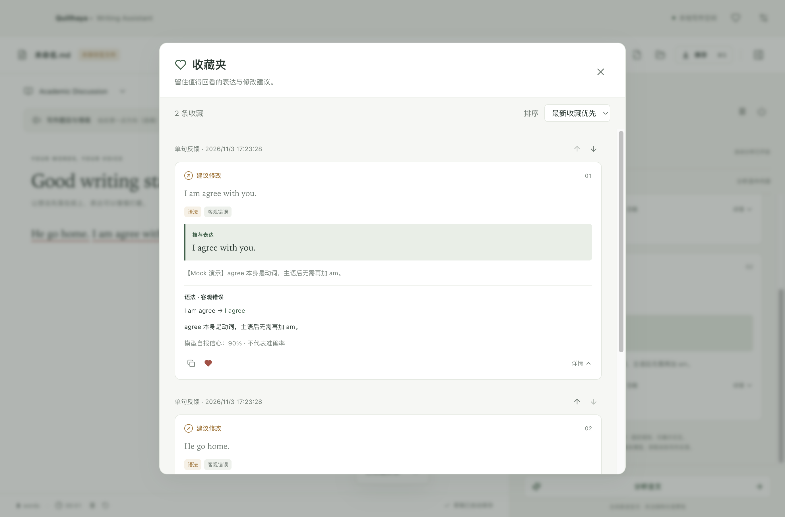
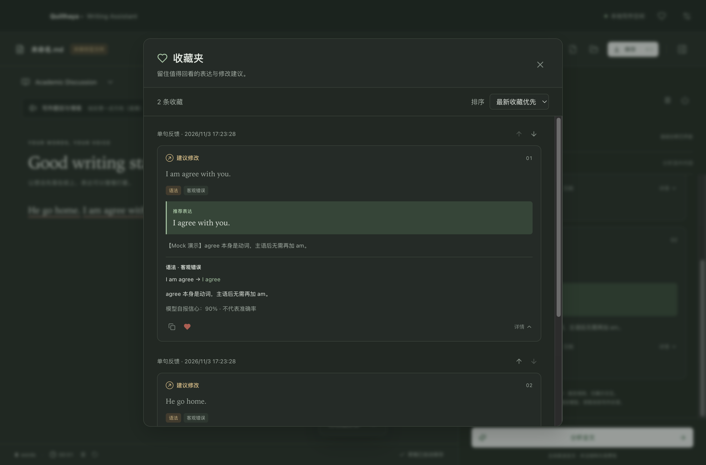

# issue1103：反馈收藏

日期：2026-11-03。在 `dev` 分支实现。功能验收阶段未打包；之后按用户要求更新为 1.0.3 并生成 macOS arm64 DMG，打包验证见 [VALIDATION.md](VALIDATION.md)。

## 使用方式

- 反馈卡片在复制推荐句的右侧新增爱心，空心表示未收藏，实心表示已收藏；再次点击取消。没有推荐句的反馈仍可收藏。
- 主界面右上角爱心打开收藏夹，支持 Escape 关闭。
- 单句和全文反馈均可保存。收藏夹展示完整原文、推荐表达、总体中文解释、每条问题的分类/严重程度/原片段/建议片段/中文说明、模型自报信心与收藏时间。
- 新收藏默认按时间逆序显示。每条收藏右上方的上移/下移按钮切换到自定义顺序并保存；排序选择框可切回时间逆序。
- 取消收藏不删除正文，也不删除正在显示的分析结果；写作页与收藏夹的爱心状态同步。

## 技术栈与文件职责

沿用 TypeScript、React、Electron、Zod、Node 文件 API、Lucide 图标、Vitest 和 Playwright，无新依赖。

| 文件 | 职责 |
| --- | --- |
| `src/models/favorites.ts` | 收藏输入、记录、排序和文件结构的严格 Zod 校验；跨会话内容去重及排序函数 |
| `electron/storage/favorites.ts` | `favorites.json` 的读取、原子写入、串行修改、去重、删除和完整 ID 集合校验 |
| `electron/main.ts` / `preload.ts` | 收藏列表、添加、取消、排序四个白名单 IPC；继承主窗口来源校验；正常退出等待收藏写入 |
| `src/core/useFavorites.ts` | 读取本地收藏、统一处理操作状态/错误、同步各卡片的爱心状态 |
| `FeedbackCard.tsx` | 复制按钮旁爱心；收藏夹复用只读卡片，不提供接受修改或重新请求模型的动作 |
| `FavoritesDialog.tsx` / `styles/favorites.css` | 收藏窗口、数量、空状态、错误重试、排序与上下移动，适配明暗主题 |

## 保存内容与一致性

每条记录为 `{ id, createdAt, scope, result }`。`id` 和时间由主进程生成，`result` 保留完整已校验的模型结果。文件同时保存 `sort` 和条目数组的手动顺序。

收藏以 **当次分析结果中的 `original_text`** 为原文，而非当前编辑器文本。即使正文已改、卡片正在保留旧意见，收藏也不会把新原句与旧建议错误配对。收藏不依赖文档 ID、模型配置或编辑器偏移，因此更改正文、关闭应用、切换文档都不会覆盖它；不额外保存邻句上下文或认证信息。

去重比较范围、原文、推荐表达、总体解释、全部问题和信心值；忽略仅用于当前写作会话的 `sentence_id`，所以同一反馈不会因为会话 ID 改变而重复收藏。重新评估得到不同反馈时，可作为新的完整记录保存。

所有修改在主进程同一 Promise 队列中串行执行，读取最新状态后修改，以临时文件写入再 rename 替换；写入成功后才更新内存和 UI。排序请求必须包含当前所有 ID 且不重复，防止陈旧排序丢失条目。退出前等待队列完成。写入失败时原记录及爱心状态保留，可重试。

收藏文件损坏时明确提示并保留原文件，拒绝静默覆盖；写作功能继续可用，修复文件后可在收藏夹重新加载。文件位于当前应用数据目录，沿用安装版/开发版隔离规则，与普通草稿一样是本地未加密文字数据；文件创建权限为 0600。

## 验证

- 6 项新增存储测试：完整快照与重启、并发去重/删除、自定义顺序与恢复时间排序、无效排序 ID、损坏文件保护/重试、写入失败不改变内存/重试。
- 6 项新增 Electron 测试：爱心位置、旧反馈原文快照与重启、逆序/手动排序持久化/双向取消同步、全文反馈、失败保存、损坏收藏不阻塞写作、无效 IPC、明暗主题。
- 已查看真实 Electron 收藏夹明暗主题截图；操作沿用按钮键盘交互，收藏夹可滚动且无横向溢出。
- 实际命令和完整回归数量见 [VALIDATION.md](VALIDATION.md)。测试只使用隔离临时目录、合成反馈和 Mock/本地测试服务。

## 界面预览

